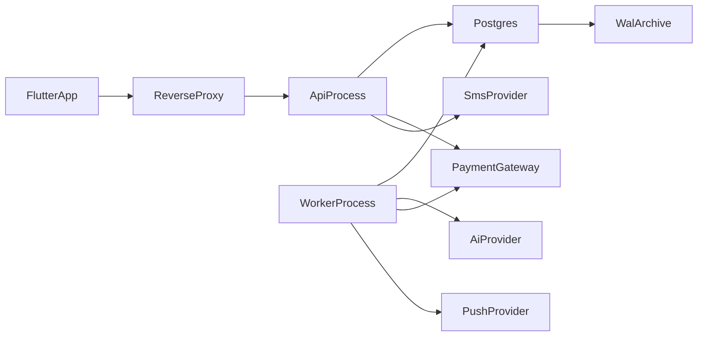
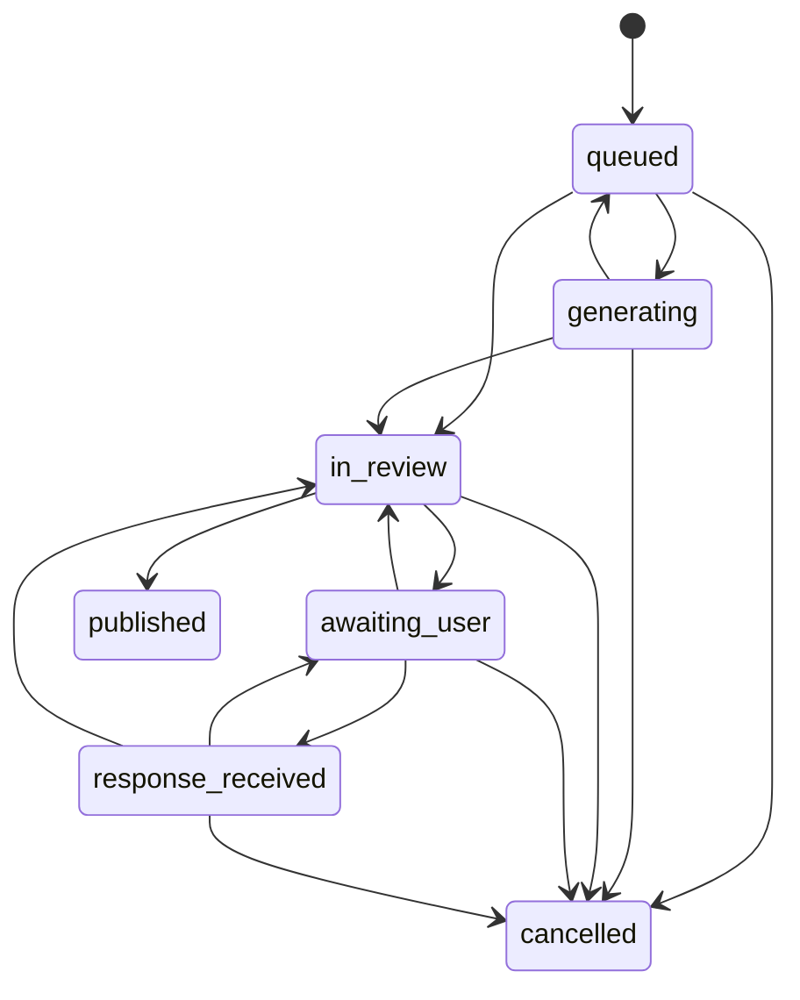
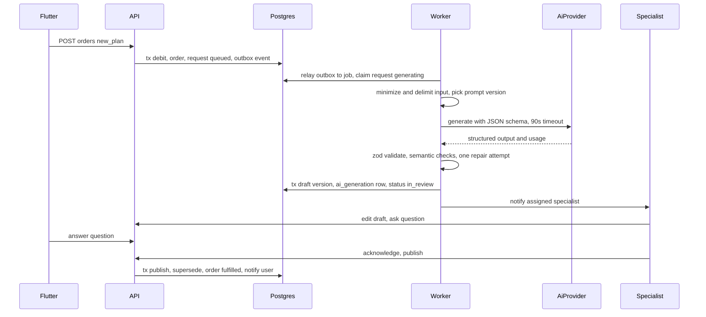

# Sabzine backend design

Reviewed specification. Phase 0 of this repository implements the runtime only. The product modules described below are not built yet.

Working decisions for implementation are the three ADRs in `docs/adr/` and the list below. Where a later **DECISION** tag disagrees with this list, this list wins.

1. AI calls go through `PlanDraftProvider`. The concrete model is chosen when that module is built.
2. No user withdrawals. Service refunds return to the wallet. A bank refund is a manual admin adjustment.
3. The wallet has `cash` (gateway top-ups) and non-withdrawable `promo` (rewards). Purchases spend promo first.
4. A published plan covers today through Friday of the current Tehran week. The specialist may choose next Saturday instead.
5. One plan per `week_start`. The next week can be bought while the current week is active. One reward per week.
6. A meal can be logged only on its Tehran calendar date. The grace window setting defaults to 0.
7. The API accepts an undo on the same Tehran day. An awarded reward is never revoked.
8. Each purchase confirms the current questionnaire summary. A full re-entry is required when required questions change, or pregnancy data is older than 28 days.
9. Public ratings use approved reviews only.
10. Age under 18 is rejected until a guardian flow exists.
11. Eating-disorder history, high-risk pregnancy, and kidney disease skip AI and go to the specialist with an empty draft.
12. An AI failure does not refund the order. The specialist still delivers the plan.
13. Push notifications are phase 2. The first product version uses in-app notices and polling.

Prices stay server-side, in toman: new plan 500,000; AI revision 150,000; specialist revision 250,000; weekly reward 200,000; top-ups of 200,000, 500,000, 800,000, and 1,000,000 credited one-to-one.

---

## 1. Findings from the Flutter source

All state lives in one `ChangeNotifier`, `DemoStore` in [lib/data/demo_store.dart](lib/data/demo_store.dart). It persists to `SharedPreferences` under the keys `sabzine.questionnaire.v1`, `sabzine.mock-wallet.v1`, `sabzine.demo-session.v1`, `sabzine.meal-log.v1` and `sabzine.workspace-settings.v1`. There is no network code; `pubspec.yaml` depends only on `shared_preferences`. The 8 test files (about 57 tests) construct `DemoStore` directly.

**Roles and login (existing)**
- [lib/screens/entry.dart](lib/screens/entry.dart): the user picks a role ("ورود به عنوان ..."), and `login(AppRole)` trusts that choice. The phone regex is `^09\d{9}$`, the demo code is `123456`, and the "ورود مستقیم با حساب نمایشی" button logs in with `09120000000`.
- Session: `login()` sets `sessionExpiresAt = today + 30 days`. `restoreUserSession()` rejects sessions where `expires - issued != 30d` and never extends them. This already matches the "opening the app does not extend" rule, but it is enforced only on the client.
- Acquisition resume: `startPlanAcquisition()` sets an in-memory `pendingPlanAcquisition`. `PanelShell.didChangeDependencies` reopens `openPlanServices` once the user is signed in and the questionnaire is complete. The flag is lost on app restart or web reload.

**Questionnaire (existing)**
- `QuestionnaireData` stores **Persian display strings as values**. Examples: `goal == 'کاهش وزن'`, `pregnant => lifeStage == 'باردار هستم'`, health `'حساسیت غذایی دارم'`. There is already a legacy alias that maps `'تغذیهٔ متعادل'` and `'بهبود عادت غذایی'` to `'تغذیهٔ سالم'`. Numbers are strings that may contain Persian digits.
- The default constructor is pre-filled with sample data ("سارا احمدی", 28, 165, 72), which must never become a server default.
- `isComplete` rules:
  - Target weight is required for weight loss or gain when not pregnant, and must be below current weight for loss and above it for gain.
  - Pregnancy week must be an integer from 1 to 42, and pre-pregnancy weight is required.
  - `babies` is required when pregnant; `nursingAge` is required when breastfeeding.
  - Any health option other than "موردی ندارم" requires `healthDetails`. Food allergy requires `allergies`, and medication requires `medicines`.
  - Consent must be true.
  - Generic numeric bound is 0 to 500, which is weak.
- Allergen and reaction share one text field, and medicines and supplements share another.
- [lib/data/form_config.dart](lib/data/form_config.dart) `FormConfiguration`:
  - 6 sections; the last one is the review step.
  - Built-in (`core`) question ids match the JSON keys.
  - Admins can edit `title`, `helper` and `choiceLabels` (display overrides of the semantic value).
  - Custom questions can be `text`, `number`, `single` or `multiple`, with `required` and `enabled` flags.
  - Custom option answers are stored as option text, so renaming an option breaks old answers.
  - Saving the config can flip `questionnaireNeedsReview`. The config is device-local, so admin edits affect only that device.

**Wallet (existing, after `e8ba373`)**
- [lib/data/wallet_catalog.dart](lib/data/wallet_catalog.dart) defines the services in toman: `new-plan` 500,000, `ai-change` 150,000 and `expert-change` 250,000.
- Charges `p50/p200/p300/p500` credit 200k, 500k, 800k and 1M toman at face value. `kInitialWalletBalance = 0`.
- `weeklyRewardToman = 200000` is admin-editable via [lib/screens/pricing_admin.dart](lib/screens/pricing_admin.dart). Per-week amounts are snapshotted in `rewardAmounts`.
- `tryPurchasePlanService` debits the wallet and then calls `submitQuestionnaire()`, which creates the request. Revision purchases only set `revisionRequested` on the current request. There is no refund path.
- The debug tools `setDebugWalletBalance` and `WalletDebugPanel` exist. `MockPaymentScreen` renders **card number, CVV2 and second-password fields** inside the app; production must remove these.

**Requests and plans (existing)**
- `PlanStatus` has the values `incomplete, queued, generating, reviewing, needsInfo, ready`. The specialist is assigned **by name string** (`r.specialist = selected`), and `assignedDoctor` matches by name.
- A plan is `draft` (day 0) plus `draftOtherDays` (days 1 to 6), with Saturday as index 0.
- `Meal{name,title,time,amount,details,kind,calories}` stores `amount` as free-text lines like "item: quantity unit". `kind` is an illustration index, not a meal type, and `name` holds the meal-type label ("صبحانه").
- `approve()` requires all 7 days to be non-empty, plus a non-empty title and amount and calories greater than 0 for every meal. It copies the draft to `published`, sets `programStartsOn ??= today` and `programWeek ??= startOfWeek(today)` (so revisions keep the original week), and increments `version`.

**Clarification questions (existing)**
- There is a single `question` string; `needInfo()` overwrites it with no history and also posts it as a chat message.
- **Any** user chat message in `user-main` while the status is `needsInfo` becomes the answer (`send()` side effect). This violates the brief.
- `markInfoAnswerReviewed` gates `canApproveInformation`.

**Tracking (existing)**
- The meal-log key is `date|requestId|index|title|calories`, so editing a meal orphans its log.
- Only today is loggable (`canLog`), and an eaten checkbox cannot be unticked in the UI, although `setMealEaten(false)` exists. Past day tabs are disabled.
- `mealsOn` returns empty outside `programWeek`, so there is no auto-repeat. All dates use the device clock (`DateTime.now()`), not Asia/Tehran.
- Weight history is in memory with one entry per day.

**Rewards (existing)**
- `scheduledWeekDates` runs from `programStartsOn` to Friday. `weeklyProgramCompleted` requires the last date to be on or before today and every day to be complete. `claimWeeklyReward` is keyed by `programWeek` in `rewardedWeeks`.
- `pendingWeeklyRewards` drives the popup in `WeeklyRewardGate` ([lib/widgets/weekly_progress.dart](lib/widgets/weekly_progress.dart)). The streak is the number of consecutive rewarded weeks, alive if the last reward is in the current or previous week. Undoing a meal never revokes a reward.

**Messaging, reviews, specialists (existing)**
- Thread ids are hard-coded (`user-main`, `support-main`, ...). Experts see **all** non-support threads (no assignment filter). Unread state is an in-memory seen-set.
- Reviews have a rating from 1 to 5. They are gated on a completed week (`feedbackProgram`), limited to one per week, matched by author **name string**, and also copied into the support thread.
- `ExpertRecord` mixes the private `mobile` with public fields. `DoctorDetailsScreen` shows medical code, city, address, clinic phone, hours, degree, experience and bio. `capacity` and `active` exist but are not enforced.

**Other demo affordances to remove in production:** `setDemoStatus`, `loginDemoUser`, `attachDemoUserRequest`, the role picker, and the hard-coded `notices`, `supportTickets` and `weightEntries`.

---

## 2. Requirements, assumptions, open decisions

**Confirmed (from the brief plus your answers)**
- Three roles, with all access control enforced on the server.
- Guest browsing, and SMS OTP login triggered only by the acquisition flow.
- A fixed 30-day session.
- Versioned questionnaire, AI draft, specialist approval, and immutable published versions.
- A clarification-question state machine.
- Asia/Tehran calendar with a Saturday-to-Friday week.
- A weekly reward with a uniqueness constraint.
- Isolated messaging.
- Admin features without any food bank.
- **Wallet in toman.** Initial configurable prices are taken from the current prototype: plan 500,000, AI revision 150,000, specialist revision 250,000, charges of 200k/500k/800k/1M at face value, and a weekly reward of 200,000.

**Assumptions**
- One account has exactly one role. Staff accounts are created by an admin, and a specialist who wants to be a patient uses a different number.
- A user has at most one open (non-terminal) request at a time, matching the single `userRequestId` in the prototype.
- An AI-assisted revision still requires specialist approval (the brief says AI output is never visible without approval). The services differ in who drafts and in SLA, not in review.
- Wallet money can be spent only on services and cannot be withdrawn in MVP.

**Open decisions**
1. **AI provider reachability and legality from Iran.** Major LLM APIs block Iranian traffic and raise sanctions questions. The options are a domestic or self-hosted open-weight model, or a relay abroad (which needs legal sign-off). The adapter design keeps the provider switchable.
2. **Stored-value regulation.** Holding real toman balances may fall under Central Bank or Shaparak e-wallet rules. Legal review is needed. The design does not claim compliance.
3. **Reward economics.** A 200k reward is 40% of a plan and is credited for self-reported data. I propose a separate non-withdrawable `promo` bucket.
4. **Short first week.** A plan published on Friday makes a one-day "week" eligible for the full reward (prototype behaviour). Options: keep it, set a minimum number of qualifying days, prorate, or start late-week plans the next Saturday.
5. **Late logging grace.** Should Friday dinner logged at 00:30 Saturday count? Today the prototype says no.
6. **Undo.** Should eaten meals be un-tickable on the same day? The UI says no; the store allows it.
7. **Minors.** Is there an age floor or guardian consent? The prototype allows ages from 0 to 500.
8. **Splitting fields.** Should allergen and reaction, and medicines and supplements, become separate fields (schema v2)?
9. **Free corrections.** A specialist-initiated correction of a published plan (`kind=correction`, no charge): allowed?
10. **Review display name** (proposed: first name plus last initial) and per-specialist ratings (the prototype averages all reviews).
11. **Push channel:** FCM versus Iranian push services, and whether to send SMS for plan-published and question-asked events.
12. **Admin access to care chats.** Proposed: only via an audited "break-glass" with a recorded reason.
13. **Refunds of top-ups to a bank card:** manual or out of scope in MVP?

---

## 3. Stack and architecture

**Stack**
- Node 22 LTS, TypeScript, NestJS (its modules map onto the bounded contexts below).
- PostgreSQL 16, accessed through Drizzle ORM. Migrations are SQL-first; partial unique indexes, `CHECK` constraints and `SELECT ... FOR UPDATE` are all needed.
- zod for API DTOs and for the AI output schema, from a single source. OpenAPI is generated from the zod schemas, and the Dart client models are generated from OpenAPI.
- pg-boss as a Postgres-backed queue, fed by a transactional outbox.
- No Redis in MVP: rate limits use Postgres counters.

**Topology:** one codebase with two entrypoints:
- `api`: HTTP.
- `worker`: AI jobs, outbox relay, payment reconciliation, notifications, and stuck-job reapers.

Behind them sit one PostgreSQL primary with WAL archiving and a reverse proxy (Caddy or Nginx). Hosting would be in an Iranian data center, because payment gateways typically require registered Iranian callback IPs and the SMS providers are Iranian. AI egress is isolated behind the provider adapter (see decision 1).

**Why a modular monolith:** the hardest invariants span modules inside one transaction. "Debit, then order, then request, then job" and "meal log, then reward, then ledger credit" both need a single ACID transaction. Splitting services would turn these into sagas without any scale benefit at Sabzine's size. The only isolation need is AI latency, which the separate `worker` process already handles.

**Alternatives considered:**
- Dart (Serverpod) shares models with Flutter but has a thinner ecosystem for payments, SMS and LLMs.
- Django has a strong built-in admin, but Sabzine's admin UI already exists in Flutter.



---

## 4. Modules and responsibilities

- `identity`: OTP challenges, phone normalization, sessions, refresh rotation, devices, rate limits.
- `users`: account, role, status, display name, acquisition state.
- `questionnaire`: schema versions, drafts, submissions, conditional validation, risk flags, legacy-value mapping.
- `catalog`: services, price versions, charge packages, reward policies.
- `wallet`: wallets, ledger, orders, idempotency records, nightly ledger reconciliation.
- `payments`: gateway adapter (Zarinpal-style request/verify/inquiry), callbacks, reconciliation.
- `requests`: plan requests, assignment (automatic least-loaded, plus admin override), state machine, timeline events.
- `plans`: versions, days, meals, items, draft editing with optimistic locking, publish validation, immutability triggers.
- `clarifications`: information questions, answers, acknowledgements.
- `ai`: provider interface, prompt templates, input minimization, output validation and repair, usage and cost.
- `tracking`: Tehran calendar, effective version per date, meal logs, weights, dashboard aggregation.
- `rewards`: weekly eligibility, award, streak, acknowledgement.
- `messaging`: care and support conversations, participants, read cursors, pagination.
- `specialists`: profiles (public and private split), verification, capacity, availability.
- `reviews`: submission eligibility, moderation, public listing.
- `notifications`: in-app notifications, push, SMS templates.
- `audit`: append-only audit log and health-data access log.
- `platform`: outbox, job scheduling, `Clock` (an injectable Tehran clock), config, error mapping.

**Rule:** modules call each other through exported services and never write to another module's tables. The only exceptions are the two documented cross-module transactions, which run through a shared unit of work.

---

## 5. Database entities

IDs are UUIDv7. All timestamps are `timestamptz` in UTC, and calendar dates are `date` in Asia/Tehran. Amounts are `bigint` toman, with `_toman` suffixes everywhere; rial appears only on `payments`.

**Identity**
- `users(id, phone_e164 UNIQUE, role CHECK in (user, specialist, admin), status (active, suspended, deleted), display_name, current_submission_id, created_at)`
- `otp_challenges(id, phone_e164, code_hmac, expires_at, attempts, max_attempts, send_count, last_sent_at, consumed_at, locked_at, ip, device_id)`, indexed on `(phone_e164, created_at DESC)`.
- `sessions(id, user_id, created_at, absolute_expires_at, revoked_at, revoke_reason, platform, device_id, last_seen_at)`, indexed on `(user_id) WHERE revoked_at IS NULL`.
- `refresh_tokens(id, session_id, token_hash UNIQUE, issued_at, used_at, replaced_by_id, grace_response_enc)`
- `devices(id, user_id, session_id, platform, push_provider, push_token UNIQUE, updated_at)`
- `rate_limit_counters(bucket_key, window_start, count, PRIMARY KEY(bucket_key, window_start))`

**Questionnaire**
- `questionnaire_schemas(version PK, status (draft, published, retired), definition jsonb, published_at, published_by)`. A partial unique index allows only one row `WHERE status='published'`.
- `questionnaire_drafts(user_id PK, schema_version, answers jsonb, lock_version, updated_at)`
- `questionnaire_submissions(id, user_id, schema_version, answers jsonb, display_snapshot jsonb, risk_flags text[], consent_version, consent_at, pregnancy_week_as_of date, submitted_at)` is immutable, indexed on `(user_id, submitted_at DESC)`.

**Catalog**
- `services(code PK in (new_plan, ai_revision, specialist_revision), title, active)`
- `service_prices(id, service_code, price_toman CHECK > 0, valid_from, valid_to, created_by)`. A partial unique index allows one row per `service_code WHERE valid_to IS NULL`.
- `charge_packages(id, code, credit_toman, price_toman, active, sort, valid_from, valid_to)`
- `reward_policies(id, code (weekly_completion, signup_bonus), amount_toman, active, params jsonb, valid_from, valid_to)`. A signup bonus exists only if an admin creates an active row; the default is none.

**Wallet**
- `wallets(user_id PK, cash_toman CHECK >= 0, promo_toman CHECK >= 0, version, updated_at)`
- `wallet_ledger(id, user_id, entry_kind (topup_credit, service_debit, refund_credit, reward_credit, bonus_credit, admin_adjustment), bucket (cash, promo), delta_toman CHECK <> 0, cash_after, promo_after, source_type, source_id, created_by, created_at)`. Constraints:
  - `UNIQUE(source_type, source_id, entry_kind, bucket)`
  - Append-only: the application's database role has INSERT and SELECT only, and a trigger rejects UPDATE and DELETE.
- `orders(id, user_id, service_code, service_price_id, price_toman, paid_cash_toman, paid_promo_toman, status (paid, fulfilled, refunded), target_plan_version_id, revision_reason, revision_details, created_at)`
- `idempotency_records(user_id, key, route, request_hash, state (in_progress, done), response_status, response_body, created_at, PRIMARY KEY(user_id, key))`, with a TTL of 24 hours.

**Payments**
- `payments(id, user_id, package_id, credit_toman, amount_toman, amount_rial CHECK amount_rial = amount_toman*10, gateway, authority UNIQUE, ref_id UNIQUE, status, callback_at, verified_at, verify_code, failure_reason, created_at)`
- No card data is stored at all; any masked PAN returned by the gateway is dropped.

**Requests and plans**
- `plan_requests` columns: `id, request_no bigserial UNIQUE, user_id, kind (new_plan, ai_revision, specialist_revision, correction), order_id UNIQUE NULL, submission_id, base_plan_version_id, assigned_specialist_id, status, ai_failed bool, risk_flags text[], priority, lock_version, created_at, updated_at`.
- `plan_requests` constraints and indexes:
  - Partial unique `(user_id) WHERE status NOT IN ('published','cancelled')`, so there is one open request per user.
  - Index on `(assigned_specialist_id, status, created_at)`.
  - Index on `(status, created_at) WHERE assigned_specialist_id IS NULL`.
- `request_events(id, request_id, from_status, to_status, actor_id, actor_role, reason, created_at)` provides the timeline.
- `plan_versions(id, request_id, user_id, version_no, status (draft, published, superseded, discarded), source (ai, blank, copy, specialist), based_on_version_id, ai_generation_id, week_start date, effective_from date, note, lock_version, published_at, published_by)`. Constraints:
  - `UNIQUE(request_id, version_no)`
  - Partial unique `(request_id) WHERE status='draft'`
  - Partial unique `(user_id, week_start, effective_from) WHERE status='published'`
- `plan_days(id, plan_version_id, day_index 0..6 (0 = Saturday), UNIQUE(plan_version_id, day_index))`
- `plan_meals(id, plan_day_id, meal_uid uuid, position, meal_type (breakfast, morning_snack, lunch, afternoon_snack, dinner, evening_snack, other), custom_type_label, suggested_time time, title, calories int CHECK > 0, notes, preparation, required bool DEFAULT true, origin (ai, specialist), UNIQUE(plan_day_id, position))`
  - `meal_uid` stays the same when a meal is edited or copied into a revision, and is new when a meal is added.
- `plan_meal_items(id, meal_id, position, name, quantity numeric(8,2) CHECK > 0, unit (gram, ml, piece, glass, cup, tablespoon, teaspoon, slice, palm, to_taste, other), unit_label, household_measure, notes)`. There is no catalogue table; items belong to their meal.
- A trigger blocks INSERT, UPDATE and DELETE on days, meals and items whose version status is not `draft`.

**Clarifications**
- `info_questions(id, request_id, asked_by, text, required bool, status (open, answered, acknowledged, withdrawn), asked_at, answered_at, acknowledged_at, acknowledged_by, ack_note, withdrawn_at, withdraw_reason)`, indexed on `(request_id, status)`.
- `info_answers(id, question_id, author_id, text, created_at)` keeps every revision; the latest one is current.

**AI**
- `prompt_templates(id, key, version, body, output_schema_version, UNIQUE(key, version))`
- `ai_generations(id, request_id, attempt_no, provider, model, prompt_template_id, input_hash, status, started_at, finished_at, latency_ms, input_tokens, output_tokens, cost_micro_usd, error_code, validation_errors jsonb, raw_output_enc, raw_output_expires_at, UNIQUE(request_id, attempt_no))`

**Tracking and rewards**
- `meal_logs(id, user_id, scheduled_date, meal_uid, plan_version_id, plan_meal_id, eaten bool, calories_snapshot, title_snapshot, logged_at, undone_at, UNIQUE(user_id, scheduled_date, meal_uid))`
- `weight_entries(id, user_id, measured_on date, weight_kg numeric(5,2), source (questionnaire, manual), UNIQUE(user_id, measured_on))`
- `weekly_rewards(id, user_id, week_start date, first_day date, qualifying_days, amount_toman, policy_id, ledger_entry_id, awarded_at, acknowledged_at, UNIQUE(user_id, week_start))`

**Messaging**
- `conversations(id, kind (care, support), patient_id, specialist_id, status, last_message_at)`. Constraints:
  - Partial unique `(patient_id, specialist_id) WHERE kind='care'`
  - Partial unique `(patient_id) WHERE kind='support' AND status='open'`
- `conversation_participants(conversation_id, user_id, role, active bool, last_read_message_id, PRIMARY KEY(conversation_id, user_id))`
- `messages(id, conversation_id, sender_id, sender_role, kind (text, system, question_ref), info_question_id, body, created_at)`, indexed on `(conversation_id, id DESC)`.

**Specialists, reviews, notifications, audit**
- `specialist_profiles(user_id PK, full_name, specialty, qualifications, experience_years, medical_council_no UNIQUE, city, clinic_address, clinic_phone, working_hours jsonb, bio, verification_status (pending, verified, rejected, suspended), verified_by, verified_at, accepting bool, capacity int, private_mobile, private_email, private_notes)`. The `public_specialist_profiles` view exposes only the public columns.
- `reviews(id, user_id, request_id, week_start, rating 1..5, text, status (pending, approved, rejected), moderated_by, moderated_at, reject_reason, UNIQUE(user_id, week_start))`
- `notifications(id, user_id, type, payload jsonb, created_at, read_at, acknowledged_at)`, indexed on `(user_id, created_at DESC)`.
- `outbox_events(id, topic, aggregate_id, payload, created_at, dispatched_at, attempts)`, indexed on `(created_at) WHERE dispatched_at IS NULL`.
- `audit_logs(id, actor_id, actor_role, action, entity_type, entity_id, diff_redacted jsonb, ip, correlation_id, created_at)` is append-only.
- `data_access_logs(id, actor_id, subject_user_id, resource, reason, created_at)`

---

## 6. State transitions

### OTP challenge
- `none -> sent`. Actor: guest. Guards: the phone normalizes to `+989XXXXXXXXX`, and the per-phone, per-IP and per-device limits are not exceeded.
- `sent -> sent` (resend). Guards: the cooldown has elapsed (60s, then 120s, then 300s), there have been fewer than 5 sends in the hour and fewer than 10 in the day, and the new code invalidates the previous one.
- `sent -> verified`. Guards: the code HMAC matches in constant time, `now < expires_at` (120s), `attempts < 5`, and the challenge is not consumed. The verify step creates the session.
- `sent -> locked` after 5 wrong attempts. Three locked challenges within an hour block the phone for 30 minutes.
- `sent -> expired` after the TTL.

### Session
- `none -> active` on OTP verify. `absolute_expires_at = now + 30d` and never changes afterwards.
- `active -> active` on refresh rotation. Guards: the refresh token is unused (or reused within a 30s grace window), the session is not revoked, and `now < absolute_expires_at`.
- `active -> revoked` on logout, admin action, refresh-token reuse outside the grace window, or account suspension.
- `active -> expired` when `now >= absolute_expires_at`.

### Plan request (actor and guards)

Status inside `{in_review, awaiting_user, response_received}` is always recomputed from the questions in the same transaction:
- `awaiting_user` if any required question is `open`;
- otherwise `response_received` if any required question is `answered`;
- otherwise `in_review`.



- `[*] -> queued`. Actor: system, inside the order transaction. Guards: the debit succeeded, the submission is complete under the current schema, and the user has no other open request.
- `queued -> generating`. Actor: worker. Guard: `UPDATE ... WHERE status='queued' RETURNING` won.
- `queued -> in_review`. Actor: worker, when AI is skipped (risk flags, kill switch, or a `specialist_revision` or `correction`). A blank draft, or a copy of the base version, is created.
- `generating -> in_review`. Actor: worker. A valid AI draft is stored; or, after retries are exhausted, `ai_failed=true` and a blank or copied draft is created.
- `generating -> queued`. Actor: reaper, when the lease is older than 15 minutes and there are fewer than 3 attempts.
- `in_review|response_received -> awaiting_user`. Actor: the assigned specialist asks a required question.
- `awaiting_user -> response_received`. Actor: the request owner answers the last open required question.
- `response_received|awaiting_user -> in_review`. Actor: the assigned specialist acknowledges or withdraws the last blocking question.
- `in_review -> published`. Actor: the assigned specialist, who must be verified and active. Guards:
  - no required questions in `open` or `answered`;
  - the draft `lock_version` matches;
  - publish validation passes;
  - all risk flags are acknowledged in the request body.
- `* -> cancelled`. The user can cancel only from `queued` or `generating`; an admin can cancel any non-terminal request with a reason. Open questions are withdrawn and the order is refunded.
- Assignment is orthogonal: an admin can reassign in any non-terminal state, and pending questions carry over to the new specialist.

**Concurrency:** every transition takes `SELECT ... FROM plan_requests WHERE id=$1 FOR UPDATE` first. That serializes a publish racing with a new question, an answer racing with an acknowledgement, and two specialist tabs.

### Information question
- `none -> open`. Actor: the assigned specialist. Guards: the request is in a review state, and the text is 1 to 1000 characters.
- `open -> answered`. Actor: the request owner, only through `POST /info-questions/{id}/answer`. Chat messages never change this state.
- `answered -> answered`. The owner revises the answer before acknowledgement; a new `info_answers` row is written and history is kept.
- `answered -> acknowledged`. Actor: the assigned specialist, with an optional note. This state is terminal.
- `open|answered -> withdrawn`. Actor: the assigned specialist with a reason, or the system on cancellation.

### Plan version
- `none -> draft`. Actor: system (AI, blank or copy). One draft per request.
- `draft -> draft`. Actor: the assigned specialist. Guard: `If-Match: lock_version`.
- `draft -> published`. Covered by the request publish guard. The server sets `published_at`, `week_start` and `effective_from` (section 9).
- `published -> superseded`. Actor: system, when a later version for the same user and week is published.
- `draft -> discarded` on cancellation.
- Published rows are immutable (database trigger).

### Payment
- `created -> pending_redirect` when the gateway returns an authority; otherwise `created -> failed_to_initiate`.
- `pending_redirect -> cancelled` when the callback has `Status != OK`.
- `pending_redirect -> verifying` when the callback has `Status = OK`.
- `verifying -> paid`. The verify API returns success (or "already verified") with the **server-stored** amount, and the ledger is credited in the same transaction.
- `verifying -> failed`. Verify returned a definitive failure.
- `verifying -> unknown`. Verify timed out; the reconciler calls inquiry and resolves to `paid` or `failed`.
- `pending_redirect -> expired`. No callback arrived within 30 minutes and inquiry reports the payment unpaid. If inquiry reports it paid, the flow goes through verify to `paid`.

### Order
- `none -> paid` (inside the debit transaction).
- `paid -> fulfilled` (request published).
- `paid -> refunded`. Guarded by the refund policy; there is one `refund_credit` per order through the ledger unique key.

### Weekly reward (per user and `week_start`)
- `not_awarded -> awarded`. Actor: system, inside the meal-log transaction. Guards: section 9 eligibility and `INSERT ... ON CONFLICT (user_id, week_start) DO NOTHING` returning a row.
- `awarded -> acknowledged`. Actor: the owner dismisses the popup.
- There is no revocation in MVP, matching the prototype.

---

## 7. API catalogue (`/v1`)

**Conventions**
- Bearer access token.
- Errors are RFC 9457 `problem+json` with `code` and `messageFa`.
- Cursor pagination with `?cursor=&limit=` (maximum 50).
- `Idempotency-Key` header on money-moving POSTs.
- A resource the caller does not own returns **404**, not 403, to prevent enumeration.
- Each request loads the role from the database through the session row; the token's role claim is never trusted.

**Role rules summary**
- **User** sees only rows with `user_id = me`.
- **Specialist** must be `verified` and `active`, and sees only requests where `assigned_specialist_id = me` plus those patients' care conversations and plan history.
- **Admin** has global management access. Reads of health data require a `reason` and are recorded in `data_access_logs`.

**Guest / public**
- `GET /public/catalog`: services, current prices, charge packages and the active reward amount.
- `GET /public/reviews`: approved reviews only.
- `GET /public/daily-message?date=`
- `GET /questionnaire/schema`: the current published labels.

**Auth**
- `POST /auth/otp/request`
- `POST /auth/otp/verify`
- `POST /auth/refresh`
- `POST /auth/logout`
- `GET /auth/sessions`, `DELETE /auth/sessions/{id}` (own sessions only)

**User (role `user`, owner)**
- `GET /me`, `PATCH /me`
- `GET /me/acquisition-state`
- `GET /me/dashboard?date=`
- `GET /me/sync?since=` (cheap counters endpoint for polling)
- `GET|PUT /me/questionnaire/draft`
- `POST /me/questionnaire/submissions`
- `GET /me/questionnaire/current`
- `GET /me/wallet`
- `GET /me/wallet/ledger`
- `POST /me/orders` (idempotent)
- `GET /me/orders/{id}`
- `POST /me/payments` (idempotent)
- `GET /me/payments/{id}`
- `GET /me/requests`
- `GET /me/requests/{id}` (timeline, questions, public specialist profile)
- `POST /me/requests/{id}/cancel`
- `GET /me/info-questions?status=open`
- `POST /me/info-questions/{id}/answer`
- `GET /me/plan?date=` (effective version for the week)
- `GET /me/plan-versions/{id}` (published versions only)
- `PUT /me/meal-logs/{date}/{mealUid}`
- `DELETE /me/meal-logs/{date}/{mealUid}`
- `GET /me/rewards?pending=true`
- `POST /me/rewards/{id}/acknowledge`
- `GET|POST /me/weights`
- `GET /me/specialist`
- `POST /me/reviews` (eligibility: a completed week, one per week)
- `GET /me/notifications`
- `POST /me/notifications/{id}/read`
- `POST /me/devices`, `DELETE /me/devices/{id}`

**Payment callback (public, untrusted input)**
- `GET /payments/callback/{gateway}?pid=&Authority=&Status=`: performs server-side verification, then redirects to the app deep link or the web route.

**Conversations (participant check)**
- `GET /conversations?kind=`
- `POST /me/support-conversation`
- `GET /conversations/{id}/messages?before=`
- `POST /conversations/{id}/messages`
- `POST /conversations/{id}/read`

**Specialist (assigned only)**
- `GET /specialist/queue?bucket=awaiting_review|awaiting_user|response_received|revisions|generating|published`
- `GET /specialist/requests/{id}` (snapshot, risk flags, draft, questions; logs data access)
- `GET /specialist/requests/{id}/draft`
- `PUT /specialist/requests/{id}/draft` (full replace, `If-Match`)
- `POST /specialist/requests/{id}/draft/days/{dayIndex}/meals`
- `PATCH /specialist/drafts/meals/{mealId}`
- `DELETE /specialist/drafts/meals/{mealId}`
- `POST /specialist/requests/{id}/draft/validate`
- `POST /specialist/requests/{id}/publish`
- `POST /specialist/requests/{id}/info-questions`
- `POST /specialist/info-questions/{id}/acknowledge`
- `POST /specialist/info-questions/{id}/withdraw`
- `GET /specialist/patients/{userId}/plan-versions`
- `GET|PUT /specialist/profile` (public fields; private fields are editable by the owner but never served to users)

**Admin**
- Users:
  - `GET /admin/users`, `GET /admin/users/{id}`
  - `POST /admin/users/{id}/suspend|activate`
- Specialists:
  - `POST /admin/specialists`, `PATCH /admin/specialists/{id}`
  - `POST /admin/specialists/{id}/verify|reject|suspend`
- Requests and plans:
  - `GET /admin/requests`
  - `POST /admin/requests/{id}/assign`
  - `POST /admin/requests/{id}/cancel`
  - `GET /admin/plan-versions/{id}?reason=`
- Questionnaire schemas:
  - `GET /admin/questionnaire/schemas`
  - `POST /admin/questionnaire/schemas` (draft from current)
  - `PATCH /admin/questionnaire/schemas/{v}`
  - `POST /admin/questionnaire/schemas/{v}/publish`
- Support and reviews:
  - `GET /admin/support-conversations`
  - `GET /admin/reviews?status=pending`
  - `POST /admin/reviews/{id}/approve|reject`
- Pricing and rewards:
  - `POST /admin/services/{code}/prices` (new price version)
  - `GET|POST|PATCH /admin/charge-packages`
  - `GET|POST /admin/reward-policies`
- Money:
  - `GET /admin/ledger?userId=`
  - `GET /admin/payments`
  - `POST /admin/wallet-adjustments` (reason and idempotency key required)
- Observability:
  - `GET /admin/audit-logs`
  - `GET /admin/ai-generations`

---

## 8. Representative JSON

OTP request:

```json
POST /v1/auth/otp/request
{ "phone": "۰۹۱۲ ۳۴۵ ۶۷۸۹", "deviceId": "b6f1..." }
-> 200 { "challengeId": "0193...", "phoneMasked": "+98912***6789", "expiresInSec": 120, "resendAfterSec": 60 }
```

OTP verify:

```json
POST /v1/auth/otp/verify
{ "challengeId": "0193...", "code": "482913", "platform": "android" }
-> 200 { "accessToken": "eyJ...", "accessExpiresAt": "2026-10-28T06:15:00Z",
         "refreshToken": "rt_9a...", "sessionExpiresAt": "2026-11-27T06:00:00Z",
         "user": { "id": "0193...", "role": "user", "isNew": true } }
```

On web, the refresh token is set as an HttpOnly cookie and omitted from the body.

Acquisition state:

```json
GET /v1/me/acquisition-state
-> { "questionnaire": "needs_review", "reasons": ["new_required_question:cq_01J..."],
     "openRequest": null, "nextStep": "questionnaire", "walletToman": 300000 }
```

Order:

```json
POST /v1/me/orders   Idempotency-Key: 6c1e...
{ "serviceCode": "new_plan", "expectedPriceToman": 500000 }
-> 201 { "order": { "id": "0193...", "priceToman": 500000, "paidCashToman": 300000, "paidPromoToman": 200000, "status": "paid" },
         "request": { "id": "0193...", "requestNo": 1043, "status": "queued" },
         "wallet": { "cashToman": 0, "promoToman": 0 } }
-> 409 { "code": "price_changed", "currentPriceToman": 550000 }
-> 402 { "code": "insufficient_balance", "shortfallToman": 200000 }
```

Payment:

```json
POST /v1/me/payments   Idempotency-Key: 77aa...
{ "packageCode": "p500", "expectedPriceToman": 1000000, "returnTo": "app" }
-> 201 { "paymentId": "0193...", "amountToman": 1000000, "amountRial": 10000000,
         "redirectUrl": "https://gateway.example/StartPay/A0000..." }
```

Dashboard (abridged):

```json
GET /v1/me/dashboard
-> { "today": { "date": "2026-10-28", "jalali": "1405-08-06", "weekdayIndex": 4, "tz": "Asia/Tehran" },
     "week": { "weekStart": "2026-10-24", "firstDay": "2026-10-25", "completedDays": 3, "scheduledDays": 6, "streakWeeks": 2 },
     "todayMeals": [ { "mealUid": "0193...", "mealType": "breakfast", "suggestedTime": "08:00", "title": "...",
                       "calories": 440, "items": [ { "name": "نان سنگک", "quantity": 60, "unit": "gram", "householdMeasure": "۲ کف دست" } ],
                       "eaten": true, "loggable": false } ],
     "calories": { "target": 1790, "consumed": 440 },
     "weight": { "currentKg": 72.0, "targetKg": 66.0, "history": [ { "date": "2026-10-20", "kg": 72.6 } ] },
     "pregnancy": null,
     "request": { "requestNo": 1042, "status": "awaiting_user", "openQuestions": 1 },
     "pendingRewards": [], "dailyMessage": "...", "specialist": { "fullName": "...", "specialty": "..." } }
```

Answering a question:

```json
POST /v1/me/info-questions/0193.../answer
{ "text": "شام معمولاً ساعت ۹ شب؛ متفورمین ۵۰۰ روزانه" }
-> 200 { "question": { "id": "0193...", "status": "answered" }, "request": { "status": "response_received" } }
```

Publish:

```json
POST /v1/specialist/requests/0193.../publish
{ "draftVersionId": "0193...", "lockVersion": 14, "acknowledgedRiskFlags": ["pregnant"] }
-> 409 { "code": "blocking_questions", "questionIds": ["0193..."] }
-> 422 { "code": "plan_incomplete", "issues": [ { "dayIndex": 3, "mealId": "...", "field": "items", "rule": "min_1" } ] }
-> 200 { "versionNo": 2, "weekStart": "2026-10-24", "effectiveFrom": "2026-10-28" }
```

Logging a meal that completes the week:

```json
PUT /v1/me/meal-logs/2026-10-30/0193...   { "eaten": true }
-> 200 { "log": { "eaten": true, "caloriesSnapshot": 490 },
         "reward": { "id": "0193...", "amountToman": 200000, "weekStart": "2026-10-24", "message": "۲۰۰٬۰۰۰ تومان جایزه به کیف پولت اضافه شد" } }
```

---

## 9. AI generation and specialist review



**Input minimization**
- Sent: age, sex, height, weight, goal codes, target weight, life-stage codes, pregnancy week (advanced by `pregnancy_week_as_of`), condition codes, activity and lifestyle codes, preference, budget and cooking codes, and free text (`healthDetails`, `allergies`, `medicines`, `dislikes`, custom answers).
- Free text is truncated to 500 characters per field, and phone and national-ID patterns are stripped.
- Never sent: name, phone, user id. A request pseudonym is used instead.

**Untrusted text:** free text is placed inside a delimited `user_supplied_data` JSON block. The system prompt tells the model to treat it as data only. The output schema has no free-form instruction channel, and red-team fixtures run in CI.

**Output schema**
- Exactly 7 `days` (`dayIndex` 0 to 6). Each meal has `mealType`, `suggestedTime HH:mm`, `title`, `items[{name, quantity, unit, householdMeasure?}]` (at least 1), `calories`, and optional `notes` and `preparation`.
- Top-level `assumptions[]`, `warnings[]` and `missingInformation[]` are shown to the specialist, not the user.

**Semantic checks:** calories per meal and per day fall within configured bands, units come from the enum, and listed allergens are string-matched against item names. The matches produce warnings for the specialist; they do not block the draft.

**Retries**
- Transient errors (timeout, 429, 5xx): up to 3 attempts with backoff.
- Schema-invalid output: 1 repair call with the validation errors.
- After that, set `ai_failed=true` and create a blank draft (or a copy of the base version). No automatic refund, because the paid service is a specialist-reviewed plan. **DECISION.**

**High-risk handling**
- Risk flags are computed when the questionnaire is submitted: `pregnant`, `breastfeeding`, `high_risk_pregnancy`, `gestational_diabetes`, `eating_disorder_history`, `kidney`, `liver`, `diabetes_with_medication`, `minor`, `bmi_under_18_5_with_loss_goal`, `pregnancy_with_loss_goal`, `multiple_pregnancy`.
- Configurable flags such as `eating_disorder_history` skip AI entirely. Every flag raises queue priority and must be explicitly acknowledged when publishing.

**Tracking:** each generation records the prompt template key and version, provider, model, output schema version, latency, tokens and cost. A daily cost cap and a kill switch live in config.

**Assignment:** at request creation, pick the least-loaded verified, active, accepting specialist below `capacity`. Revisions go to the original specialist when available. If no one is available, the request is unassigned and appears in the admin queue.

**Dates at publish:** `week_start` is the Tehran Saturday of the publish date (prototype `programWeek ??=`). For a revision, `effective_from` is the publish date; for the first plan of a week it is also the publish date (prototype `programStartsOn ??=`). Days before `effective_from` keep the previously effective version. The "effective version for date D" is the latest published version for that week with `effective_from <= D`. There is no automatic carry-over to the next week.

**Publish validation:**
- Every day index 0 to 6 has at least 1 meal (prototype rule).
- Every meal has a type, a time, a non-empty title, at least 1 item with quantity greater than 0 and a unit, and calories greater than 0.
- Daily calorie totals outside the configured band produce warnings.

---

## 10. Wallet, payments, refunds, idempotency

**Purchase transaction (`POST /me/orders`):**
1. Insert `idempotency_records(user, key, state=in_progress)`. On conflict:
   - `done` returns the stored response;
   - `in_progress` returns 409 `retry_later`;
   - a different `request_hash` returns 422.
2. Load the active `service_prices` row. If `expectedPriceToman` differs, return 409 `price_changed`.
3. Check the preconditions:
   - the submission is current and complete;
   - there is no open request (the partial unique index is the backstop);
   - a revision targets a published version owned by the user in the current week.
4. `SELECT ... FROM wallets WHERE user_id=$1 FOR UPDATE`. Compute the split (promo first, then cash; **DECISION**) and return 402 if the total is insufficient.
5. Update the wallet balances; the `CHECK >= 0` constraint is the backstop. Insert the ledger rows (`service_debit`, one per bucket) and the `orders` row with its price snapshot. Insert the `plan_requests` row (`queued`) with `submission_id`, and an `outbox_events` row (`request.created`).
6. Mark the idempotency record `done` with the response, then commit.

**Crash analysis**
- Crash before commit: nothing persisted, so the client retries with the same key.
- Crash after commit but before the job is dispatched: the outbox relay (`FOR UPDATE SKIP LOCKED`) dispatches it later.
- Worker crash mid-generation: the pg-boss lease expires and the job is retried. The reaper also re-queues `generating` requests older than 15 minutes.
- Duplicate job execution: `UNIQUE(request_id, attempt_no)`, the status guard and the one-draft-per-request index keep a single draft.

**Payment verification**
- `POST /me/payments` snapshots `credit_toman`, `amount_toman` and `amount_rial = amount_toman * 10`. It calls the gateway request API with the callback URL `/v1/payments/callback/{gateway}?pid=` and returns `redirectUrl`. Flutter opens it in an external browser or custom tab (mobile) or the same tab (web). There are no card fields anywhere in Sabzine.
- The callback looks up the payment by `pid` and authority, takes a row lock, and is a no-op if the payment is already final. It calls verify with the **stored** rial amount. On success, a single transaction sets `paid` and inserts the `topup_credit` ledger row (unique on `('payment', id)`) to the cash bucket. The callback then redirects to `sabzine://wallet/payment-result?paymentId=` or `/wallet/payment-result`, and the app polls `GET /me/payments/{id}`.
- A reconciler runs every 5 minutes for `pending_redirect`, `verifying` or `unknown` payments older than 10 minutes, using inquiry and verify.

**Refund policy (proposal)**
- Full refund to the original buckets (`refund_credit`, unique per order) when:
  - the user cancels while the request is `queued` or `generating`;
  - an admin cancels for any reason;
  - no specialist publishes within the SLA (e.g. 7 days), on admin action or an automatic job (**DECISION**).
- No refund for AI failure, since a specialist still delivers the plan.
- Refunds of top-ups to a bank card are manual (decision 13) and are recorded as an `admin_adjustment` debit with an external reference.

**Reward credit** happens in the meal-log transaction (section 6), going to the `promo` bucket with the ledger unique key `('weekly_reward', id)`.

**Invariants:** a nightly job checks `wallets.cash/promo == SUM(ledger)` per user and alerts on any mismatch. Admin adjustments require a reason and are audited.

---

## 11. Session lifecycle

- Access token: a JWT (ES256 with a `kid` for key rotation) carrying `sub` and `sid`. TTL is `min(15 min, absolute_expires_at)`. The API checks that the `sid` row is not revoked on every request (a primary-key lookup with a 30s in-process cache), so logout and revocation take effect almost immediately.
- Refresh token: 256 random bits, stored as a SHA-256 hash and single-use. Each rotation issues a new token whose expiry equals `sessions.absolute_expires_at`; **rotation never extends the session**. If two refreshes race at app start, the second within 30s receives the same new pair (cached encrypted). Reuse after that window revokes the session.
- Opening the app calls `/auth/refresh` only when the access token is missing or expired. `sessionExpiresAt` comes back in every token response.
- After expiry, `/auth/refresh` returns 401 `session_expired`. The client clears its tokens and stays on the guest dashboard, and protected actions trigger login with a resume intent.
- Resume:
  - The client persists a non-sensitive intent `{type: "acquire_plan", serviceCode?, createdAt}` (TTL 1 hour) in `shared_preferences`.
  - After verify, it calls `GET /me/acquisition-state`; the server decides the next step: `questionnaire`, `confirm_profile`, `select_service`, or `view_request` if one is already open.
- No repeated questionnaire: the server returns `complete` unless any of these holds:
  - there is no submission;
  - the schema has a new required question;
  - built-in validation rules changed;
  - pregnancy data is older than 4 weeks (**DECISION**).
  
  Instead of the full form, the app shows the existing review step ("همه‌چیز درسته؟") for confirmation.
- Storage:
  - **Mobile:** refresh token in `flutter_secure_storage` (Keychain or Keystore), access token in memory.
  - **Web:** refresh token in an `HttpOnly; Secure; SameSite=Strict` cookie scoped to `Path=/v1/auth` on the API domain, with the app and API on the same site (`app.` and `api.sabzine.ir`). The access token stays in memory, never in `localStorage`. Refresh requires an `X-Requested-With` header, and CORS is an exact-origin allowlist.
- Staff sessions: the same OTP flow, with a 12-hour absolute lifetime for admins and 7 days for specialists (**DECISION**). Admin TOTP comes in phase 2.
- Production guard: the API refuses to boot if the SMS provider is `console` or `fake`, or if any `OTP_FIXED_CODE` is set. Staging allows a fixed code only for allowlisted test numbers.

**Phone normalization**
1. Convert Persian and Arabic digits.
2. Strip spaces, dashes and parentheses.
3. Map `+98`, `0098`, `98` (12 digits), `09XXXXXXXXX` and `9XXXXXXXXX` to `+989XXXXXXXXX`.
4. Normalize other international numbers with libphonenumber-js and reject them with `phone_not_supported` in MVP.

**OTP SMS:** sent through the provider's template ("verify lookup") API; Android SMS Retriever and iOS autofill come in phase 2.

---

## 12. Flutter integration mapping

Add `lib/data/api/` containing `ApiClient` (dio with auth and refresh interceptors), `TokenStore`, and repositories (`AuthRepo`, `QuestionnaireRepo`, `WalletRepo`, `PlanRepo`, `RequestRepo`, `MessagingRepo`, `AdminRepo`). `DemoStore` becomes a thin app-state layer over these repositories. Fake repositories keep the existing 57 tests running, and a `--dart-define=SABZINE_ENV` flag strips demo UI from prod builds.

**Auth and entry**
- `login(role, phone)`, `LoginScreen` (demo code `123456`, "ورود مستقیم") map to `POST /auth/otp/request` and `/verify`; the role comes from the server.
- `EntryScreen` role picker, `selectRole` and `showRoleSelection` become dev-only.
- `saveUserSession`, `restoreUserSession` and `SessionStorage` map to `TokenStore` plus `/auth/refresh`.
- `logout` maps to `/auth/logout`.
- `startPlanAcquisition`, `pendingPlanAcquisition` and `completeUserOnboarding` map to the persisted intent plus `/me/acquisition-state`.

**Questionnaire**
- `restoreQuestionnaire`, `saveQuestionnaire`, `questionnaireComplete` and `questionnaireNeedsReview` map to the draft and submission endpoints and acquisition-state. Persian value strings become codes through a mapping table in one Dart file.
- `restoreWorkspaceSettings` and `saveFormConfiguration` (`FormConfiguration`) map to `GET /questionnaire/schema` and the admin schema endpoints.

**Pricing and wallet**
- `savePricing`, `newPlanPrice`, `aiRevisionPrice`, `expertRevisionPrice`, `weeklyRewardToman` and `PricingAdminScreen` map to `/public/catalog`, `/admin/services/{code}/prices` and `/admin/reward-policies`.
- `walletBalance`, `walletTransactions`, `restoreWalletState` and `saveWalletState` map to `/me/wallet` and `/me/wallet/ledger`.
- `tryPurchasePlanService`, `canAfford` and `submitQuestionnaire` (request creation) map to `POST /me/orders`.
- `addWalletCredit`, `completeMockPayment` and `MockPaymentScreen` map to `POST /me/payments`, the external gateway, the deep link and `GET /me/payments/{id}`. The card, CVV2 and second-password fields are deleted.
- `setDebugWalletBalance`, `resetWalletDebug`, `WalletDebugPanel` and `kInitialWalletBalance` are removed (a dev seed script replaces them).

**Specialist review**
- `requests`, `request(id)`, `beginReview` and `RequestListScreen` map to `/specialist/queue` and `/specialist/requests/{id}`.
- `editMeal`, `addMeal` and `removeMeal` map to the draft meal endpoints. The `Meal.amount` text becomes structured `items`, and the UI keeps a text preview.
- `approve` and `approveActiveUserRequest` map to `/specialist/requests/{id}/publish`.
- `needInfo` maps to `POST /specialist/requests/{id}/info-questions`, and `markInfoAnswerReviewed` to `.../acknowledge`.
- The `send()` side effect that captures `infoAnswer` is **removed**. `RequestInformationCard` gets an answer field that posts to `/me/info-questions/{id}/answer`.
- `requestRevision` (free in the prototype UI) maps to `POST /me/orders` with a revision service plus reason and details.
- Admin `r.specialist = selected` maps to `/admin/requests/{id}/assign` by id.
- `setDemoStatus`, `loginDemoUser` and `attachDemoUserRequest` become dev-only.

**Tracking and rewards**
- `mealsOn`, `calorieTarget`, `consumedCalories`, `mealEaten`, `setMealEaten` and `restoreNutritionLog` map to `/me/plan`, `/me/dashboard` and `/me/meal-logs`. The server's `today` replaces `DateTime.now()`.
- `scheduledWeekDates`, `dayCompleted`, `weeklyStreak`, `claimWeeklyReward`, `rewardedWeeks` and `pendingWeeklyRewards` map to `dashboard.week` and `/me/rewards?pending=true`. The client never claims a reward.
- `acknowledgeWeeklyReward` maps to `/me/rewards/{id}/acknowledge`. The popup's "دریافت برنامه جدید" calls `openPlanServices` (the normal paid flow).
- `addWeight`, `weightEntries` and `latestWeight` map to `/me/weights`.

**Messaging, reviews, notifications, profiles**
- `chatThreads`, `threadMessages`, `unreadCount`, `markThreadRead`, `visibleThreads`, `receivedThreads` and `send` map to `/conversations*`. `supportTickets` maps to support conversations.
- `programReviews`, `submitProgramReview`, `approveProgramReview`, `rejectProgramReview` and `canReviewCurrentProgram` map to `/me/reviews`, `/admin/reviews` and `/public/reviews`. Reviews are no longer copied into the support thread.
- `notices` map to `/me/notifications`.
- `notificationsEnabled` and `mealReminders` map to device preferences (phase 2).
- `assignedDoctor`, `experts`, `saveExpertProfile` and `updateProfileName(expert)` map to `/me/specialist`, `/specialist/profile` and `/admin/specialists`.
- `toggleHabit` and `completedHabits` stay local in MVP (there is no backend requirement for them).

---

## 13. Test scenarios

**Money**
- Two parallel `POST /me/orders` with the same key produce one order and an identical replayed response.
- With different keys and a balance that covers only one, one call gets 201 and the other 402, and the balance never goes negative.
- A price changes between display and purchase, returning 409 `price_changed` with no debit.
- The payment callback is hit concurrently by the browser and the reconciler, producing one credit. A replayed callback for an already-paid payment is a no-op.
- A forged callback (wrong authority, another user's `pid`, tampered amount) fails verify against the stored amount, and nothing is credited.
- A verify timeout leaves the payment `unknown`; the reconciler resolves it and credits exactly once.
- A refund retried twice produces one `refund_credit`. The nightly reconciliation detects an injected drift.

**Jobs and AI**
- Killing the API after commit but before outbox dispatch: the job still runs.
- Killing the worker mid-call: lease expiry, then a retry, then a single draft.
- A duplicate job delivery produces a single draft.
- Invalid JSON goes through the repair call; a second failure produces a blank draft with `ai_failed`.
- Prompt-injection fixtures in `dislikes` and `healthDetails` still yield schema-valid output.
- A high-risk flag skips AI.
- The cost cap triggers the kill switch.

**Review workflow**
- Publish and ask-question racing from two tabs: the row lock lets exactly one win, and publish then fails with `blocking_questions`.
- Answer and acknowledge race: the acknowledgement covers only the answer revision it read.
- A user chat message while awaiting a response does not change the question state.
- A second question after an acknowledgement blocks publish again.
- A stale `lockVersion` on draft save or publish returns 409.
- A reassigned specialist (and the previous one) cannot act.
- Editing a published version is rejected by the database trigger.

**Tracking and rewards**
- A double-tap PUT produces one row.
- Logging at 23:59:59 versus 00:00:00 Asia/Tehran follows the server date, even with a wrong device clock.
- Past and future dates return 409.
- Two devices logging Friday's last two meals concurrently produce exactly one reward (unique constraint).
- Undoing and re-ticking produces no second reward.
- A revision published on Friday creates no duplicate.
- A reward policy change mid-week leaves the awarded amount equal to the value at award time.
- An empty or incomplete schedule never qualifies.

**Sessions and auth**
- Refresh on day 30 plus 1 second returns 401.
- Parallel refreshes at startup both succeed through the grace window.
- A reused old refresh token revokes the session.
- After logout, the access token is rejected.
- Brute-forcing the OTP locks the challenge.
- Cooldowns are enforced.
- Persian-digit, `+98` and `0098` inputs normalize correctly.
- A prod boot with a fake SMS provider fails.

**Authorization:** a generated matrix of every endpoint by role (guest, user A, user B, specialist assigned, specialist unassigned, unverified specialist, admin) asserts 401, 404 or 200.

**Questionnaire**
- Publishing a new required custom question makes acquisition-state report `needs_review`, without touching existing plans.
- A retired option still renders historically.
- Renaming a label keeps codes and pregnancy logic intact.
- The legacy Persian values `تغذیهٔ متعادل` and `بهبود عادت غذایی` map to `healthy_eating`.

**Operations:** a quarterly restore drill from PITR into staging.

---

## 14. Cross-cutting operations (summary)

- **Migrations:** SQL-first with Drizzle, reviewed in PRs, expand and contract, run as a release step before the new API starts, plus a CI check against a fresh database and a production-like snapshot.
- **Events and jobs:** a transactional outbox feeds pg-boss, every handler is idempotent, and failed jobs go to a dead-letter queue visible in admin.
- **Validation:** zod on every DTO, a 32 KB body limit, Persian and Arabic digit normalization on input, and cursor pagination.
- **Real-time:** MVP polls `GET /me/sync` every 30s in the foreground and chat every 5s with an `after` cursor. Phase 2 moves to SSE.
- **Notifications:** an in-app table is the source of truth, with push through a pluggable provider (decision 11) and SMS only for critical events.
- **Secrets:** per-environment secrets in a vault or sops-encrypted deploy repo, never in git. Rotation applies to the JWT `kid`s, the OTP pepper, the gateway merchant id, the SMS key, AI keys and the field-encryption key.
- **Health data:**
  - Access is limited to the assigned specialist; admin reads require a reason.
  - All staff reads are recorded in `data_access_logs`.
  - Volumes and backups are encrypted, with app-level encryption of free-text clinical fields in phase 2.
  - Retention: raw AI output 30 days, OTP rows 7 days, application logs 30 days. Account deletion anonymizes health data after a grace period, while the ledger keeps a pseudonymous id; the actual periods need legal input.
- **Log redaction:** pino redact paths cover phone, code, tokens, answers, message bodies and prompts; phones are masked as `+98912***6789`; Sentry (or self-hosted GlitchTip) scrubs events in `beforeSend`.
- **Audit:** append-only, with INSERT-only grants. It covers pricing, reward policy, schema publish, specialist verification, assignment, questions, publish, cancellations, refunds, adjustments, review moderation and session revocation.
- **Backups:** pgBackRest or wal-g PITR to separate storage, a daily full backup, 30-day retention. Targets: RPO 5 minutes and RTO 4 hours.
- **Monitoring:** Prometheus and Grafana track:
  - OTP delivery rate and SMS latency;
  - payment verify failures and stuck payments;
  - outbox lag and queue depth;
  - AI latency, failure rate and daily cost;
  - requests stuck in `generating`;
  - specialist queue age against the SLA;
  - ledger reconciliation results.
- **Environments:** `local` (docker compose with Postgres plus fake SMS, gateway and AI providers), `staging` (gateway sandbox, real SMS only to allowlisted numbers, synthetic data for AI), and `production`. CI runs lint, unit tests, integration tests against real Postgres (Testcontainers), concurrency tests and OpenAPI drift checks.
- These controls support, but do not by themselves establish, legal, financial or medical compliance.

---

## 15. Roadmap

**Phase 0, foundations:**
- Repo layout (`backend/` next to the Flutter app), CI, docker compose, the `platform` module (clock, outbox, jobs, errors), `audit`, and the production boot guards.

**Phase 1, MVP:**
- `identity` (OTP, sessions), `questionnaire` v1 with codes and legacy mapping, `catalog` with price versions, `wallet` and `orders`, one payment gateway with a reconciler.
- `requests` with automatic and admin assignment, `ai` with one provider plus blank-draft fallback, `plans` with draft editing and publish, `clarifications`.
- `tracking` (dashboard, meal logs, weights), `rewards`, `messaging` (care and support, polling), in-app notifications.
- Admin essentials: specialist verification and assignment, pricing and reward policy, review moderation, ledger and payment views, audit log viewer.
- Flutter: repositories, auth and wallet first, then the review workflow, then tracking. Demo code is removed from prod builds.

**Phase 2:**
- Push and SMS notifications, SSE, admin TOTP, field-level encryption, data export and deletion, a second AI provider with an A/B prompt registry, a cost dashboard, SMS autofill, meal-log anomaly flags, schema v2 (split allergy and supplement fields if approved), a manual bank-refund workflow, and per-specialist ratings.

**Phase 3, only if load requires:**
- Redis rate limiting, a read replica for admin reporting, and a separately scaled AI worker deployment. Splitting into separate services is deferred unless a concrete isolation need appears.
