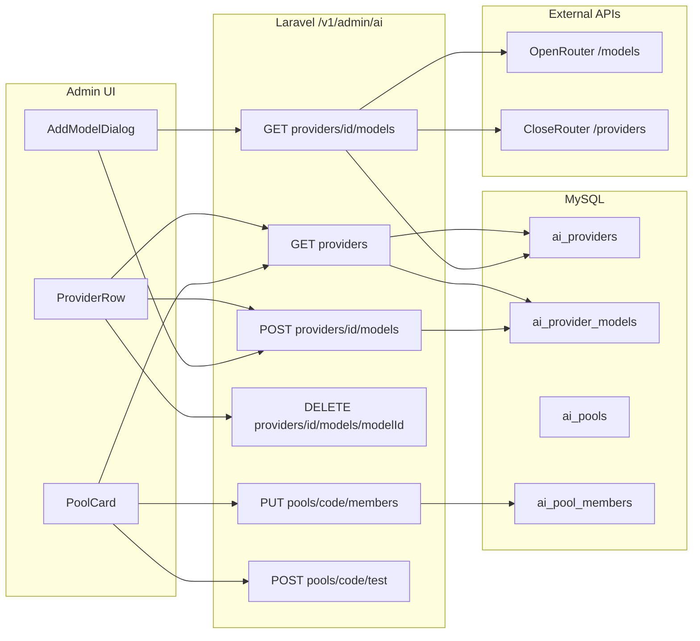

# Admin AI panel — complete change log (session 2026-11-17)

This document records **every user-facing and technical change** from the admin AI work session (including follow-ups the same day): original requirements, infrastructure setup on your machine, frontend (`AiModels.tsx`, `ai.css`, `staff-session.ts`), Laravel API, database migrations, CloseRouter catalog fix, Add-model UX (cost + count), OpenRouter timeout/cache, and local configuration.

**Format:** English first, then فارسی (Persian), with matching section numbers.

**Primary files:** `frontend/src/features/admin/features/ai/AiModels.tsx`, `ai.css`, `backend-laravel/app/Modules/Ai/*`, migrations dated `2026_11_17_*`.

---

## Table of contents

| § | Topic |
|---|--------|
| 0 | User requests mapped to implementation |
| 1 | Architecture overview |
| 2 | Local dev & login (no repo secrets) |
| 3 | Frontend — detailed |
| 4 | Backend API — detailed |
| 5 | Database |
| 6 | `ProviderClient` & CloseRouter |
| 7 | Configuration & contracts |
| 8 | End-to-end flows |
| 9 | File-by-file reference |
| 10 | Tests & verification |
| 11 | Limitations & follow-ups |
| 12 | Add-model catalog UX & performance (cost, count, timeouts, cache) |

---

# English

## §0 User requests → what was built

| Time / order | Your request (summary) | Outcome |
|--------------|------------------------|---------|
| 1 | Show admin panel locally and log in | Vite admin on `http://localhost:3001`; later **real** admin login with workspace rules (`admin` + dev password from `tool/create-admin-once.php` / rules doc) |
| 2 | Service modal: 3 kinds — OpenRouter, CloseRouter, OpenAI-compatible; auto-fill base URLs; manage models from panel; per-coach model + **test coach** | Kinds + `baseUrls` in UI; coach `PoolCard` redesigned; test on **coach** kept; model picking uses saved subset (see §3.3) |
| 3 | Could not add CloseRouter service / test it | Blockers were DB/API/auth; fixed by MySQL 8.4 + migrations + real login |
| 4 | Eye on API key in service modal | `showKey` state + password/text toggle + `Icon name="eye"` |
| 5 | On service row: remove **تست**, add **افزودن**; searchable full catalog; saved models as children | `ProviderRow` + `AddModelDialog` + `ai_provider_models` + POST/DELETE API |
| 6 | Close Router shows 2 models vs ~156 on site | `ProviderClient::models()` uses `/providers` for `closerouter` |
| 7 | Write full MD changelog (EN + FA) | This file |
| 8 | In Add dialog: show **cost per model** and **total model count** in search area | `modelCostLabel()`, `.ai-catalog-count`, `.ai-model-cost` |
| 9 | Open Router Add: timeout «پاسخ سرور به‌موقع نرسید» | Frontend catalog `GET` **90s**; `ProviderClient` **90s** + **10 min** Laravel cache; loading hint |

**Note on OpenRouter URL:** You asked for `https://openrouter.ai/ap/v1` in chat; the implemented default is the correct API base **`https://openrouter.ai/api/v1`** (see `baseUrls` in `AiModels.tsx`).

---

## §1 Architecture overview

Three layers work together:

1. **Live catalog (read-only, not stored)** — `GET /v1/admin/ai/providers/{id}/models` → Laravel `MySqlAiAdmin::models()` → `ProviderClient::models()` → upstream `GET …/models` or `GET …/providers` (CloseRouter).
2. **Saved models per service (stored)** — table `ai_provider_models`; exposed as `provider.models[]` on `GET /v1/admin/ai/providers`; written via `POST` / `DELETE` …`/models`.
3. **Coach assignment (stored)** — table `ai_pool_members`; UI selects only from `provider.models[]`; saves via `PUT /v1/admin/ai/pools/{code}/members`; tests via `POST …/test`.



**Distinct concepts (important):**

| Concept | Table | Meaning |
|---------|--------|---------|
| Service / provider | `ai_providers` | Name, kind, base URL, encrypted API key |
| Model attached to service | `ai_provider_models` | Admin picked a catalog entry to “belong” to this service |
| Coach pool | `ai_pools` | One of five coaches (`coach_memory`, `nutrition_coach`, …) |
| Active model for coach | `ai_pool_members` | Which `provider` + `model` string that coach uses at runtime |

Deleting a provider **CASCADE** deletes its `ai_provider_models` rows. Deleting a provider still **blocked** if referenced in `ai_pool_members`.

---

## §2 Local development & admin login (session operations)

These steps were done on your PC so the panel talks to a real API and database. **They are not all committed** (especially `.env`).

| Item | Value / action |
|------|----------------|
| PHP | 8.4 (`C:\xampp\php\php.exe`) |
| API | `php backend-laravel\artisan serve --host=127.0.0.1 --port=8000` |
| MySQL | 8.4.9 at `127.0.0.1:3306`, database `sabzine` |
| MySQL start | XAMPP / `C:\xampp\mysql84\` per workspace rules; session included fixing MySQL not running |
| Admin UI | `http://localhost:3001` (proxies `/v1` → API) |
| Real admin login | `POST /v1/auth/admin/login` — username **`admin`**, password per local dev rule **`Sabzine-Admin-2026`** (created via `tool/create-admin-once.php` when DB was ready) |
| Health | `GET /health/ready` → `database: up` |
| `AI_HTTP` | Set to **`true`** in `backend-laravel/.env` locally (see §7) |

**Preview mode:** Admin can show fixture data without API. AI tab uses `demoProvider` / `demoPools` when `preview` is true; mutations disabled.

---

## §3 Frontend — detailed

**Route:** Admin → **هوش مصنوعی** → tab **سرویس‌ها و استخرها** (`AiModels` inside `AiPage`).

### §3.1 Module-level constants (`AiModels.tsx`)

| Symbol | Purpose |
|--------|---------|
| `kinds` | Maps `openrouter` → `OpenRouter`, `closerouter` → `CloseRouter`, `openai_compatible` → `سازگار با OpenAI` |
| `baseUrls` | Default API bases when **creating** a service: OpenRouter `https://openrouter.ai/api/v1`, CloseRouter `https://api.closerouter.dev/v1`, compatible `''` |
| `strategies` | Pool strategy labels (unchanged): priority, cost_first, weighted |
| `demoProvider` | Preview fixture; includes `models: [{ id, model, name, price… }]` |
| `demoPools` | Five coaches with sample members for preview |

### §3.2 `ProviderRow` (service list row)

**Structure:**

- Outer `div.ai-provider` with `aria-busy` while delete mutation runs.
- **Header row** `div.ai-row`: name, `baseUrl`, badges (active, kind, key hint), actions.
- **Child list** `ul.ai-saved-models` or empty paragraph `p.ai-saved-empty`.
- Optional `AddModelDialog` when `adding === true`.
- Error line `p.ai-feedback` if remove fails.

**Actions (left to right on row):**

| Control | Behavior |
|---------|----------|
| **افزودن** | `setAdding(true)`; disabled in `preview` |
| **ویرایش** | Opens `ProviderDialog` edit |
| **حذف** | Opens delete confirm dialog |

**Removed (vs earlier UI):**

- **تست** on the service row (was calling `POST providers/{id}/test` and showing `ai-test-result`).
- Cost warning note above the provider list about test spend.

**Saved model line:**

- Shows `model` (slug) in `<bdi>`, optional `name` if different from slug.
- **حذف** → `DELETE providers/{providerId}/models/{modelId}` where `modelId` is UUID from DB (`model.id` in JSON), not the slug.

**State:**

- `adding: boolean`
- `remove: useMutation` with `onSuccess` → toast + `refresh()` (refetch providers + pools).

### §3.3 `AddModelDialog`

**Mount:**

- `useEffect` on `[provider.id]` fetches `GET providers/{id}/models?limit=2000`.
- Sets `items` via `itemRows(data)` (expects `{ items: [...] }` from API).
- `loading` → false in `finally`; errors → `failure` string.

**Search:**

- Controlled input `query`; filter `shown = items.filter(...)` where `term` matches substring in `model.id` + `model.name` (case-insensitive).
- Server also supports `?q=` but the dialog uses **client-side** search only.

**Selection:**

- `owned = Set` of `str(model.model)` from `provider.models` (already persisted slugs).
- Each catalog row is a `<button role="option">` with `id` = upstream model id (slug).
- Disabled if: `preview`, already in `owned`, or any add in progress (`busy !== ''`).
- `choose(model)` → `POST` body:

```json
{
  "model": "<slug>",
  "name": "<display name>",
  "priceInMicrosPerM": <int>,
  "priceOutMicrosPerM": <int>
}
```

- Prices: `Math.round(Number(...))` or 0 if not finite.
- On success: `added('مدل به سرویس اضافه شد.')` → parent `notify` + `refresh()`; dialog stays open until user closes (add does not auto-close dialog in code—only refresh updates parent list).

**Model count in search bar (follow-up):**

- State `catalogTotal` from API field `total` (fallback: `items.length`).
- `countLabel`: without search → `num(totalCount) + ' مدل'` (Persian digits via `formatFaNumber`).
- With search → `num(shown.length) + ' از ' + num(totalCount) + ' مدل'`.
- Rendered inside `label.users-search` as `#ai-catalog-count.ai-catalog-count`; hidden while `loading` or `failure`.
- Search input `aria-describedby="ai-catalog-count"`.

**Cost per row (follow-up):**

- Helper `modelCostLabel(model)`:
  - Uses `priceInMicrosPerM`, `priceOutMicrosPerM`, optional `free` from catalog API.
  - If `free === true` or both prices 0 → **«رایگان»**.
  - Else → `ورودی ${usd(inn, 3)}/M · خروجی ${usd(out, 3)}/M` (USD per **million tokens**, same convention as `AiReports`).
- Third line on each picker button: `<small class="ai-model-cost"><bdi dir="ltr">…</bdi></small>`.
- On POST save, the same micro prices are persisted into `ai_provider_models`.

**Loading copy (OpenRouter):**

- While fetching: «در حال دریافت مدل‌ها از سرویس… (برای OpenRouter ممکن است تا یک دقیقه طول بکشد)».

**A11y:**

- Search label with `sr-only` «جست‌وجوی مدل».
- Listbox `role="listbox"` aria-label «مدل‌های موجود در سرویس».

### §3.4 `ProviderDialog` (add / edit / delete service)

**Delete branch:** unchanged semantics — cannot delete if pool still references provider (server 409).

**Add/edit form fields:**

| Field | Create | Edit |
|-------|--------|------|
| `kind` | `<select>` controlled: `selectedKind` + `onChange` sets `baseUrl` from `baseUrls[kind]` | Disabled (kind immutable) |
| `name` | required | default from provider |
| `baseUrl` | controlled `value={baseUrl}` | same |
| `apiKey` | required | optional “کلید API جدید” |
| `httpReferer`, `appTitle` | optional | defaults from provider |
| `active` | — | select true/false |

**API key visibility (`showKey`):**

- `useState(false)` → input `type={showKey ? 'text' : 'password'}`.
- Button `icon-button`, `Icon name="eye"`, `aria-pressed={showKey}`, labels «نمایش کلید» / «پنهان کردن کلید».
- `autoComplete="new-password"` to reduce browser autofill clashes.

**Submit payload:**

- `POST providers` or `PUT providers/{id}` with `name`, `kind` (create only), `baseUrl`, optional `apiKey`, `httpReferer`, `appTitle`, `active` (edit).

### §3.5 `PoolCard` — five coaches

**Coaches** (`poolTitles` in `AiUi.tsx`):

| `code` | Persian title |
|--------|----------------|
| `coach_memory` | مربی تغذیه (حافظه) |
| `nutrition_coach` | مربی تغذیه (گفتگو) |
| `nutrition_vision` | مربی تغذیه (عکس غذا) |
| `plan_critic` | بازبینی فرهنگی و بالینی |
| `plan_draft` | پیش‌نویس برنامهٔ غذایی |

**Layout sections:**

1. **Pool settings form** — strategy, temperature, maxTokens, timeoutS (stored as `timeoutMs`), maxAttempts, enabled → `PUT pools/{code}`.
2. **مدل فعال این مربی** — shows first member with `id` (`currentMember`); remove sets draft without persisted id.
3. **انتخاب مدل جدید** — service `<select>` → `availableModels` from `providers.find(...).models` only (no live catalog fetch).
4. **Hint** if service has zero saved models: directs admin to **افزودن** on service row.
5. **انتخاب این مدل** — builds draft member with prices copied from saved model row.
6. **Tools:** «ذخیرهٔ مدل» (`PUT …/members`), «تست مربی» (`POST …/test`).

**Behavioral notes:**

- **One active member pattern:** `currentMember = members.find(m => m.id)`; draft can replace entire member list with a single new row before save.
- **تست مربی** remains; **تست سرویس** removed from service row (API endpoint still exists).
- Test result UI: Persian outcome strings via `outcomes` map + chain summary.

**Removed code:** `MemberDialog` and live `loadModels` on provider change (reduces duplicate catalog fetches and enforces “models must be added to service first”).

### §3.6 `AiModels` export

- Parallel queries: `useAiData('providers')`, `useAiData('pools')`.
- Sorts pools by `poolTitles` key order.
- Card copy updated: explains **افزودن** flow for attaching models from provider sites.

### §3.7 CSS (`ai.css`) — relevant rules

| Class | Role |
|-------|------|
| `.ai-saved-models` / `li` | Grid list under provider; bordered rows |
| `.ai-saved-empty` | Muted empty state padding |
| `.ai-dialog .ai-catalog` | Dialog body for picker |
| `.ai-catalog-search`, `.ai-catalog-count` | Search row + model count badge |
| `.ai-model-picker button .ai-model-cost` | Per-model price line in picker |
| `.ai-model-form .ai-hint` | Coach hint when no saved models |
| `.ai-form .password-field button` | Eye button alignment `top: 9px; height: 44px` |
| `.ai-model-picker` | Scrollable catalog list (max-height ~280px); option buttons |
| `.ai-pool-model-selector`, `.ai-current-model` | Coach model UX block |
| `.ai-test-result` | Styles remain in CSS but **no longer rendered** on provider row after test removal |

---

## §4 Backend API — detailed

**Prefix:** `/v1/admin/ai/` (admin JWT/session via `staff.api` on frontend).

### §4.1 Providers

| Method | Path | Handler | Notes |
|--------|------|---------|-------|
| GET | `providers` | `providers()` | Each item includes `models[]` |
| POST | `providers` | `createProvider()` | 201; kinds validated |
| PUT | `providers/{id}` | `updateProvider()` | |
| DELETE | `providers/{id}` | `deleteProvider()` | 409 if used in pool |
| POST | `providers/{id}/test` | `testProvider()` | **Still implemented**; UI removed from row |

### §4.2 Catalog vs persist models

| Method | Path | Purpose |
|--------|------|---------|
| GET | `providers/{id}/models` | Live catalog + metadata (`fetchedAt`, `total`, `suggested`, `items`) |
| POST | `providers/{id}/models` | Persist one model under service → **201** + full provider |
| DELETE | `providers/{id}/models/{modelId}` | Remove by **DB uuid** → updated provider |

**`GET …/models` query params:**

- `limit` — default **60**, max **2000** (`AiAdminController::limit($request, 60, 2000)`).
- `q` — optional server-side filter (max 80 chars), applied in `MySqlAiAdmin::models()` after fetch.

**`POST …/models` body validation (`addModel`):**

- `model` — required string, max 255 via `text()`.
- `name` — optional, max 255.
- `priceInMicrosPerM`, `priceOutMicrosPerM` — optional; `micros()` helper, non-negative.
- Duplicate `(provider_id, model)` → **409** «این مدل قبلاً به سرویس اضافه شده است».
- Audit: `ai_provider_model_added`.

**`DELETE`:**

- 404 if uuid not found for that provider.
- Audit: `ai_provider_model_removed`.

### §4.3 `MySqlAiAdmin` provider shape

`providerView($row, $models)` returns:

```json
{
  "id": "uuid",
  "name": "string",
  "kind": "openrouter|closerouter|openai_compatible",
  "baseUrl": "string",
  "httpReferer": "string|null",
  "appTitle": "string|null",
  "active": true,
  "hasKey": true,
  "keyHint": "…xxxx",
  "models": [
    {
      "id": "uuid-row-id",
      "model": "vendor/model-name",
      "name": "Display",
      "priceInMicrosPerM": 0,
      "priceOutMicrosPerM": 0
    }
  ],
  "createdAt": "ISO-8601",
  "updatedAt": "ISO-8601"
}
```

`providers()` loads all `ai_provider_models` once, groups by `provider_id`, orders by `created_at`.

**Kinds:** `private const KINDS = ['openrouter', 'closerouter', 'openai_compatible'];`

### §4.4 Pools (unchanged contract, new UI consumption)

| Method | Path | Role |
|--------|------|------|
| GET | `pools` | Five pools + `members[]` with health stats |
| PUT | `pools/{code}` | Strategy / temperature / limits |
| PUT | `pools/{code}/members` | Replace members array |
| POST | `pools/{code}/test` | Coach test completion |

Member objects still use **`model` slug string** (e.g. `deepseek/deepseek-v4.1-flash-1017`), not `ai_provider_models.id`.

### §4.5 Routes registration

`backend-laravel/routes/api.php` (admin AI group):

```php
Route::get('providers/{id}/models', 'models');
Route::post('providers/{id}/models', 'addModel');
Route::delete('providers/{id}/models/{modelId}', 'removeModel');
```

---

## §5 Database

### §5.1 Migration `2026_11_17_120000_add_closerouter_provider_kind.php`

- Drops MySQL CHECK `ai_providers_kind_check`.
- Re-adds CHECK: `kind IN ('openrouter', 'closerouter', 'openai_compatible')`.
- `down()` reverts to openrouter + openai_compatible only.

Also reflected in `contracts/mysql-schema.json`, Postgres contract, `ReplacementContractTest` create closerouter provider.

### §5.2 `ai_provider_models` (migration removed)

The create and drop migrations were deleted so a fresh database never builds this table. Prices are read from the provider API, not stored.

**Table `ai_provider_models`:**

| Column | Type | Notes |
|--------|------|-------|
| `id` | char(36) PK | UUID v4 style |
| `provider_id` | char(36) FK | → `ai_providers.id` **ON DELETE CASCADE** |
| `model` | varchar(255) | Upstream model id |
| `name` | varchar(255) NULL | Snapshot at add time |
| `price_in_micros_per_m` | bigint | default 0, CHECK ≥ 0 |
| `price_out_micros_per_m` | bigint | default 0, CHECK ≥ 0 |
| `created_at` | datetime(6) | default `current_timestamp(6)` |

**Unique:** `(provider_id, model)`.

**Idempotent:** `up()` returns early if table already exists.

**Apply:**

```powershell
php backend-laravel\artisan migrate --force
```

---

## §6 `ProviderClient` & CloseRouter catalog

**File:** `backend-laravel/app/Modules/Ai/Infrastructure/ProviderClient.php`

### §6.1 `request()` guardrails

- If `config('ai.http')` false → **503** `ai_disabled`.
- Validates URL (HTTPS in prod, optional private hosts in dev).
- DNS pinning / CURLOPT_RESOLVE for public HTTPS hosts.
- Decrypts `api_key_encrypted` with field key.
- OpenRouter extra headers: `HTTP-Referer`, `X-Title` when set on provider row.

### §6.2 `models()` catalog fetch

**Public entry** `models()`:

- If `$provider['id']` is set → `Cache::remember('ai_catalog:'.$id, 600, fn () => $this->fetchModels($provider))` (**10 minutes** TTL).
- Otherwise → `fetchModels()` without cache.

**Private** `fetchModels()`:

```php
$catalog = ($provider['kind'] ?? '') === 'closerouter' ? '/providers' : '/models';
$response = $this->request($provider, 90000)->get(rtrim($provider['base_url'], '/').$catalog);
```

- HTTP client timeout for this call: **90 seconds** (was 30s; OpenRouter ~470 models can exceed 15–30s).
- Success requires HTTP OK, body ≤ **8_000_000** bytes, `data` is array.
- Maps each row with `modelView()` if `id` is string.

**Cache note:** Key is per `ai_providers.id`; does not auto-invalidate when API key rotates (catalog listing is usually unchanged). TTL 600s limits staleness for pricing snapshots in the picker.

### §6.3 Why CloseRouter showed only 2 models

| Endpoint | With your API key (session diagnosis) |
|----------|----------------------------------------|
| `GET /v1/models` | **2** models (`total_count: 2`) — key allowlist / callable set |
| `GET /v1/providers` | **156** models — full routing catalog (matches [closerouter.dev/en/models](https://closerouter.dev/en/models)) |

Admin browsing should use **site-scale catalog** → `/providers`. Runtime inference may still **403** if key disallows that model ([key reference](https://closerouter.dev/en/docs/key-reference)).

### §6.4 Pricing normalization

| Method | Role |
|--------|------|
| `modelView($model)` | `id`, `name`, `contextLength`, micro prices, `free` flag |
| `pricing($model)` | Top-level `pricing` OR nested under `providers[]` (selected/auto/first) |
| `micros($pricing, $perToken, $perMillion)` | Reads `prompt`/`completion` OR `input`/`output`; units `usd_per_million_tokens`, `usd_per_image`, `usd_per_second`, `usd_per_request` → microdollars per million |

OpenRouter / `openai_compatible` still use **`GET …/models`**.

### §6.5 `complete()` (coach tests)

Unchanged in this session except depending on `AI_HTTP=true` and valid keys. OpenRouter body adds `provider.data_collection: deny` and `usage.include: true`.

### §6.6 Admin HTTP client timeouts (`staff-session.ts`)

Default admin `fetch` abort: **15s**. Extended for heavy AI routes:

| Pattern | Timeout |
|---------|---------|
| `POST admin/ai/.../test` (provider, pool, prompt) | **75s** |
| `GET admin/ai/providers/{id}/models` (with optional `?limit=…`) | **90s** |
| All other admin API calls | **15s** |

**Why:** OpenRouter catalog round-trip = upstream (up to 90s in PHP) + JSON parse/map + large `items[]` response. Previously the browser aborted at 15s with **`StaffError` «پاسخ سرور به‌موقع نرسید.»** (HTTP 408) while Laravel was still working.

Regex for catalog: `^admin\/ai\/providers\/[^/]+\/models(?:\?.*)?$` — query string included because `aiApi` passes `providers/{id}/models?limit=2000`.

---

## §7 Configuration & contracts

| Artifact | Change |
|----------|--------|
| `backend-laravel/.env` (local) | `AI_HTTP=true` — **do not commit** |
| `backend-laravel/config/ai.php` | `'http' => (bool) env('AI_HTTP', false)` |
| `backend-laravel/.env.example` | Documents `CLOSEROUTER_BASE_URL`, `AI_HTTP=false` default |
| `contracts/mysql-schema.json` | Table + CHECK/FK/UNIQUE for `ai_provider_models`; `closerouter` in `ai_providers` CHECK |
| `contracts/postgres-*` | `closerouter` in CHECK for parity |
| `WireAiProviders.php` | Can wire CloseRouter from env; CLI catalog may still hit `/models` only — **not updated** in this session |
| `frontend/src/shared/api/staff-session.ts` | `isAiCatalog` → **90s** abort timer for model catalog `GET` |
| `backend-laravel/tests/Feature/ReplacementContractTest.php` | Asserts creating `kind: closerouter` provider |

**Related doc (removed):** generated `AI_MODELS.md` and `tool/expand_ai_models_md.py` were optional offline catalog docs, not used by the app.

---

## §8 End-to-end flows

### §8.1 Add CloseRouter service and models

1. Admin → **افزودن سرویس** → kind CloseRouter → base auto `https://api.closerouter.dev/v1` → paste API key → save.
2. Row appears with badges.
3. Click **افزودن** → dialog loads ~156 models.
4. Type e.g. `deepseek` in search → click model → POST persists → appears under service.
5. Open coach card → select same service → model dropdown lists **only saved** models.
6. **انتخاب این مدل** → **ذخیرهٔ مدل** → **تست مربی**.

### §8.2 Remove model from service

1. Click **حذف** on saved row.
2. DELETE by row uuid.
3. Coach dropdown no longer shows removed slug (until re-added).

### §8.3 What still works without UI button

`POST /v1/admin/ai/providers/{id}/test` — service-level smoke test (optional API client / future UI).

---

## §9 File-by-file reference

| File | Every change in this session |
|------|------------------------------|
| `frontend/.../AiModels.tsx` | Kinds + `baseUrls`; `ProviderRow`; `AddModelDialog` (+ `modelCostLabel`, `catalogTotal`, count label, cost row, OR loading hint); `ProviderDialog` eye; `PoolCard`; imports `num`, `usd` |
| `frontend/.../ai.css` | Saved models, catalog dialog (+ search/count/cost), hints, pool selector, password eye; leftover `.ai-test-result` |
| `frontend/src/shared/api/staff-session.ts` | 90s timeout for `GET admin/ai/providers/*/models` |
| `frontend/.../AiUi.tsx` | No structural change; `poolTitles`, `aiApi`, `useAiData` used by new flows |
| `backend-laravel/.../MySqlAiAdmin.php` | `providers()` embeds models; `addModel` / `removeModel`; `provider()` / `providerView` / `modelView` |
| `backend-laravel/.../AiAdminController.php` | `addModel`, `removeModel`; catalog `limit` max 2000 |
| `backend-laravel/routes/api.php` | POST/DELETE provider models |
| `backend-laravel/.../ProviderClient.php` | CloseRouter `/providers`; `fetchModels` 90s; `Cache::remember` 600s; `modelView`/`pricing`/`micros` |
| `database/migrations/2026_11_17_120000_*.php` | `closerouter` kind |
| `database/migrations/2026_11_17_130000_*.php` | Removed. Do not recreate `ai_provider_models`. |
| `contracts/mysql-schema.json` | Schema contract sync |

**Not modified for Android:** `app/` Flutter — no `sync_android_studio.ps1` required.

---

## §10 Tests & verification

**Automated:** `ReplacementContractTest` posts `closerouter` provider (with test doubles for HTTP catalog).

**Manual (session):**

- Login real admin on `localhost:3001`.
- Close Router picker: **156** entries; search works.
- Open Router: hundreds of models.
- Persist add/remove under service; coach select uses subset.
- Migration applied on local MySQL 8.4.
- Eye toggle verified in browser on service modal.
- Add dialog: cost lines and model count badge; OpenRouter first load completes within 90s; second open within 10 min uses server cache.

---

## §11 Limitations & follow-ups

1. **CloseRouter:** Full catalog in UI ≠ all models callable with current key allowlist.
2. **`POST providers/{id}/test`:** API only; no service-row button.
3. **`WireAiProviders`:** May list 2 CloseRouter models until aligned with `/providers`.
4. **Prices on save:** Snapshotted at add time; upstream price changes do not auto-sync.
5. **Server `q` on catalog:** Dialog does not pass `q`; uses client filter only.
6. **Git:** No commit unless you request; never commit `.env`.
7. **OpenRouter URL typo in chat:** Implementation uses `/api/v1`, not `/ap/v1`.
8. **Catalog cache:** Up to 10 minutes stale prices in picker until TTL expires (no manual refresh button).
9. **Saved models list:** Does not yet show cost under service row (only in Add dialog).

---

## §12 Add-model catalog UX & performance (summary)

| Layer | Behavior |
|-------|----------|
| UI | Per-row **input/output $/M**; search bar **total** or **filtered of total**; long-load hint for OpenRouter |
| Browser | 90s timeout on catalog `GET` only |
| Laravel | 90s upstream HTTP; 10 min in-memory/file cache per provider id (`ai_catalog:{uuid}`) |
| Data | Prices from `ProviderClient::modelView`; stored on `POST` into `ai_provider_models` |

**OpenRouter scale:** ~470 models in API; first dialog open is slow by design; cache + longer timeouts prevent false failures.

---

---

# فارسی

## §۰ درخواست‌های شما → آنچه پیاده شد

| ترتیب | خواستهٔ شما (خلاصه) | نتیجه |
|-------|---------------------|--------|
| ۱ | نمایش پنل لوکال و لاگین | فرانت روی `localhost:3001`؛ بعداً ورود **ادمین واقعی** با قواعد لوکال (`admin` / رمز مستند در rules و `create-admin-once.php`) |
| ۲ | سه نوع سرویس، پر شدن خودکار URL، مدیریت مدل از پنل، مدل جدا برای هر یک از ۵ مربی + تست مربی | انواع سرویس و `baseUrls`؛ بازطراحی `PoolCard`؛ تست روی **مربی**؛ انتخاب مدل فقط از مدل‌های ذخیره‌شدهٔ سرویس |
| ۳ | افزودن/تست Close Router کار نمی‌کرد | MySQL ۸.۴، مایگریشن‌ها، لاگین واقعی |
| ۴ | چشم روی فیلد کلید API | `showKey` و آیکون `eye` |
| ۵ | حذف **تست** از ردیف سرویس، **افزودن** + جستجو + زیرمجموعهٔ مدل | `AddModelDialog` + جدول `ai_provider_models` |
| ۶ | Close Router فقط ۲ مدل | فراخوانی `/providers` به‌جای `/models` |
| ۷ | مستند MD کامل | همین فایل |
| ۸ | در دیالوگ افزودن: **هزینه هر مدل** و **تعداد کل مدل** کنار جست‌وجو | `modelCostLabel`، `.ai-catalog-count`، `.ai-model-cost` |
| ۹ | Open Router: خطای **پاسخ سرور به‌موقع نرسید** | تایم‌اوت **۹۰ ثانیه** مرورگر و PHP؛ کش لاراول **۱۰ دقیقه**؛ متن انتظار بارگذاری |

**نکته:** در پیام اول `https://openrouter.ai/ap/v1` آمده بود؛ در کد پیش‌فرض صحیح **`https://openrouter.ai/api/v1`** است.

---

## §۱ نمای معماری

۱. **کاتالوگ زنده (ذخیره نمی‌شود):** `GET providers/{id}/models` → `ProviderClient` → سایت OpenRouter (`/models`) یا Close Router (`/providers`).

۲. **مدل‌های ذخیره‌شدهٔ هر سرویس:** جدول `ai_provider_models`؛ در `GET providers` داخل `models[]`؛ با `POST`/`DELETE`.

۳. **تخصیص به مربی:** `ai_pool_members`؛ UI فقط از `models[]` همان سرویس؛ ذخیره با `PUT pools/{code}/members`؛ تست با `POST …/test`.

**تفاوت مفاهیم:**

| مفهوم | جدول | معنی |
|--------|------|------|
| سرویس | `ai_providers` | نام، نوع، آدرس، کلید رمز‌شده |
| مدل زیر سرویس | `ai_provider_models` | انتخاب ادمین از کاتالوگ |
| استخر مربی | `ai_pools` | یکی از ۵ مربی |
| مدل فعال مربی | `ai_pool_members` | `provider` + رشتهٔ `model` در اجرا |

حذف سرویس → CASCADE روی `ai_provider_models`؛ اگر در استخر استفاده شود حذف سرویس **۴۰۹** می‌دهد.

---

## §۲ لوکال و ورود ادمین

| مورد | مقدار |
|------|--------|
| API | `http://127.0.0.1:8000` |
| MySQL | `sabzine` روی ۸.۴.۹ |
| UI | `http://localhost:3001` |
| ادمین | `admin` / **`Sabzine-Admin-2026`** (لوکال؛ طبق rule پروژه) |
| `AI_HTTP` | **`true`** در `.env` (commit نشود) |

---

## §۳ فرانت‌اند — جزئیات

### §۳.۱ ثابت‌ها

- `kinds` و `baseUrls` برای OpenRouter، CloseRouter، سازگار با OpenAI.
- `demoProvider` در پیش‌نمایش شامل `models` نمونه است.

### §۳.۲ ردیف سرویس (`ProviderRow`)

- نوار بالا: نام، URL، بدج‌ها، **افزودن / ویرایش / حذف** (بدون **تست**).
- زیر آن: لیست مدل‌های ذخیره‌شده یا متن خالی.
- **افزودن** → دیالوگ کاتالوگ.
- **حذف** مدل → `DELETE` با UUID ردیف دیتابیس.

### §۳.۳ دیالوگ افزودن (`AddModelDialog`)

- بارگذاری: `GET …/models?limit=2000`.
- جستجو در کلاینت روی `id` و `name`.
- کلیک → `POST` با `model`, `name`, قیمت‌های micros.
- مدل قبلاً اضافه‌شده: غیرفعال، برچسب «اضافه شده».
- در حال افزودن: «در حال افزودن…»؛ بقیه دکمه‌ها موقتاً غیرفعال.
- **شمارنده:** `total` از API؛ بدون فیلتر «۴۷۰ مدل»؛ با فیلتر «۵ از ۴۷۰ مدل» (اعداد فارسی).
- **هزینه:** خط سوم هر ردیف — `ورودی $…/M · خروجی $…/M` یا «رایگان»؛ واحد میکرودلار/میلیون توکن مثل گزارش‌های AI.
- **بارگذاری OpenRouter:** یادآوری که تا یک دقیقه ممکن است طول بکشد.

### §۳.۴ مودال سرویس (`ProviderDialog`)

- انتخاب نوع → پر شدن خودکار `baseUrl` (OpenRouter / CloseRouter؛ سازگار خالی).
- چشم روی کلید: نمایش/مخفی با `aria-pressed`.
- ویرایش: نوع سرویس قفل است.

### §۳.۵ کارت مربی (`PoolCard`) — ۵ مربی

عنوان‌ها از `poolTitles`: حافظه، گفتگو، عکس غذا، بازبین برنامه، پیش‌نویس برنامه.

- تنظیمات استخر (دما، توکن، مهلت، …) جدا ذخیره می‌شود.
- **مدل فعال** نمایش داده می‌شود؛ حذف مدل از UI.
- انتخاب سرویس → فقط `provider.models` (نه fetch زنده).
- اگر سرویس مدل ندارد: `.ai-hint` با ارجاع به **افزودن**.
- **ذخیرهٔ مدل** و **تست مربی** (نه تست روی ردیف سرویس).

`MemberDialog` و بارگذاری زندهٔ کاتالوگ در استخر **حذف** شد.

### §۳.۶ استایل (`ai.css`)

- `.ai-saved-models`, `.ai-saved-empty`, `.ai-catalog`, `.ai-catalog-search`, `.ai-catalog-count`, `.ai-model-cost`, `.ai-hint`, `.ai-pool-model-selector`, `.password-field button` برای چشم.
- کلاس `.ai-test-result` هنوز در CSS هست ولی روی ردیف سرویس رندر نمی‌شود.

---

## §۴ API بک‌اند — جزئیات

**پیشوند:** `/v1/admin/ai/`

### سرویس‌ها

- `GET providers` — هر سرویس `models[]`.
- `POST/PUT/DELETE providers` — مثل قبل؛ نوع `closerouter` مجاز.

### کاتالوگ و ذخیره

| متد | مسیر | کار |
|-----|------|-----|
| GET | `providers/{id}/models` | لیست زنده؛ `limit` تا ۲۰۰۰؛ پارامتر `q` اختیاری سمت سرور |
| POST | `providers/{id}/models` | ذخیره؛ ۲۰۱؛ تکراری ۴۰۹ |
| DELETE | `providers/{id}/models/{modelId}` | حذف با UUID |

**Audit:** `ai_provider_model_added` / `ai_provider_model_removed`.

**شکل مدل ذخیره‌شده در JSON:** `id` (uuid دیتابیس), `model` (slug), `name`, `priceInMicrosPerM`, `priceOutMicrosPerM`.

### استخرها

- `PUT pools/{code}/members` — هنوز از **slug** مدل استفاده می‌کند.
- `POST pools/{code}/test` — تست مربی.

`POST providers/{id}/test` هنوز در API هست؛ دکمهٔ UI حذف شده.

---

## §۵ پایگاه داده

### مایگریشن نوع `closerouter`

CHECK روی `ai_providers.kind` شامل سه مقدار.

### جدول `ai_provider_models`

ستون‌ها: `id`, `provider_id`, `model`, `name`, قیمت‌ها، `created_at`.  
یکتا: `(provider_id, model)`.  
FK با **ON DELETE CASCADE**.

```powershell
php backend-laravel\artisan migrate --force
```

---

## §۶ `ProviderClient` و Close Router

- بدون `AI_HTTP=true` → `503 ai_disabled`.
- برای `closerouter`: `GET {baseUrl}/providers`.
- برای بقیه: `GET {baseUrl}/models`.
- پاسخ بزرگ تا ۸ مگابایت؛ تایم‌اوت HTTP کاتالوگ **۹۰ ثانیه**.
- کش: `Cache::remember('ai_catalog:'.$providerId, 600, …)` — **۱۰ دقیقه** برای هر سرویس.

**علت ۲ مدل Close Router:** `/models` محدود به مجوز کلید؛ `/providers` ~۱۵۶ مدل ([صفحهٔ مدل‌ها](https://closerouter.dev/en/models)).

توابع `modelView`, `pricing`, `micros` قیمت OpenRouter و Close Router را یکسان می‌کنند.

**هشدار:** افزودن مدل در پنل ≠ اجرای موفق اگر allowlist کلید محدود باشد.

### §۶.۶ تایم‌اوت مرورگر (`staff-session.ts`)

- پیش‌فرض ادمین: **۱۵ ثانیه**.
- `GET admin/ai/providers/.../models?...` → **۹۰ ثانیه** (رفع «پاسخ سرور به‌موقع نرسید» برای OpenRouter).
- `POST …/test` → **۷۵ ثانیه** (قبلاً هم بود).

---

## §۷ پیکربندی

- `.env` لوکال: `AI_HTTP=true`.
- `mysql-schema.json` و قرارداد Postgres هم‌خوان با `closerouter` و جدول جدید.
- `frontend/src/shared/api/staff-session.ts` — تایم‌اوت ۹۰ثانیه برای کاتالوگ مدل.
- `WireAiProviders` هنوز ممکن است فقط `/models` بخواند (کار آتی).

---

## §۸ جریان‌های کاربری

**افزودن سرویس و مدل:** افزودن سرویس → افزودن مدل از دیالوگ → ظاهر شدن زیر سرویس → انتخاب در مربی → ذخیره → تست مربی.

**حذف مدل از سرویس:** حذف از لیست → دیگر در منوی مربی دیده نمی‌شود تا دوباره افزوده شود.

---

## §۹ فهرست فایل‌ها

همان جدول بخش انگلیسی §۹ — شامل `staff-session.ts` و به‌روزرسانی‌های `ProviderClient` / `AiModels` / `ai.css` برای هزینه، شمارنده و تایم‌اوت.

تغییری در اپ Flutter (`app/`) نبود؛ sync اندروید لازم نیست.

---

## §۱۰ تست و تأیید

- تست قرارداد: ایجاد provider با `kind: closerouter`.
- دستی: ۱۵۶ مدل Close Router، جستجو، افزودن/حذف، مربی، چشم کلید، مایگریشن روی MySQL لوکال.
- دیالوگ افزودن: نمایش هزینه و شمارنده؛ OpenRouter بدون قطع ۱۵ثانیه‌ای.

---

## §۱۱ محدودیت‌ها و ادامهٔ کار

1. مجوز کلید Close Router جدا از نمایش کاتالوگ.
2. تست سطح سرویس فقط API.
3. هم‌راست‌سازی CLI با `/providers` (اختیاری).
4. قیمت‌ها لحظهٔ افزودن snapshot می‌شوند.
5. دیالوگ فقط فیلتر کلاینت دارد (`q` سرور استفاده نمی‌شود).
6. commit و push فقط با درخواست شما؛ `.env` commit نشود.
7. URL OpenRouter در کد `/api/v1` است.
8. کش کاتالوگ تا ۱۰ دقیقه — قیمت‌های picker ممکن است کمی قدیمی باشند.
9. لیست مدل‌های ذخیره‌شده زیر سرویس هنوز هزینه نشان نمی‌دهد (فقط در دیالوگ افزودن).

---

## §۱۲ خلاصهٔ UX و کارایی کاتالوگ (افزودن مدل)

| لایه | رفتار |
|------|--------|
| UI | هزینه ورودی/خروجی هر ردیف؛ شمارنده در نوار جست‌وجو؛ راهنمای زمان برای OpenRouter |
| مرورگر | ۹۰ ثانیه فقط برای `GET …/models` |
| لاراول | ۹۰ ثانیه به سرویس خارجی؛ کش ۱۰ دقیقه‌ای `ai_catalog:{id}` |
| ذخیره | قیمت‌های micros هنگام `POST` در `ai_provider_models` |

---

*Session date: 2026-11-17 (updated same day: catalog cost, count, OpenRouter timeouts) · Repository: My-Diet / Sabzine · `docs/admin-ai-changes-2026-11-17.md`*

---

